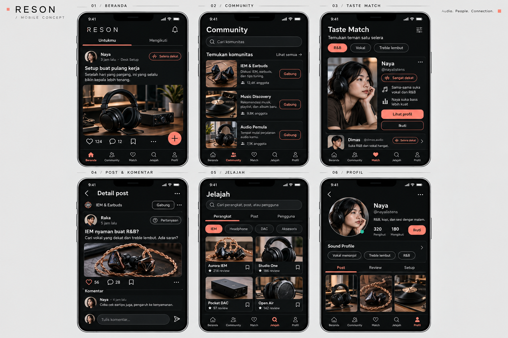

# Reson — Product Requirements Document

Versi: 1.0 • Tanggal: 25 Oktober 2026 • Bahasa produk: Indonesia

Status: konsep fitur dan arah visual disetujui pemilik; detail implementasi di bawah adalah baseline untuk pengerjaan agent. Belum ada implementasi atau deployment yang dinyatakan selesai.

## 1. Ringkasan produk

**Reson** adalah aplikasi komunitas audio yang membantu pengguna menemukan pendengar dengan selera serupa, bertukar pengalaman, dan mengeksplorasi perangkat serta musik.

Tagline: **Temukan orang yang mendengar seperti kamu.**

Pembeda utama: **Taste Match**, pencocokan preferensi suara, genre, dan kebiasaan mendengarkan dengan alasan yang dapat dipahami. Hasil tidak menjamin pengguna akan menyukai perangkat yang sama dan bukan ukuran keahlian seseorang.

Alur nilai utama:

> Daftar → mengenali selera → bergabung ke komunitas → menemukan pendengar yang relevan → membaca pengalaman → mengikuti dan berdiskusi → membagikan pengalaman sendiri.

### 1.1 Pengguna sasaran

| Pengguna | Kebutuhan | Solusi Reson |
|---|---|---|
| Pemula | Bingung istilah audio dan mencari referensi pertama | Kuis bahasa sederhana, pilihan belum tahu, komunitas Audio Pemula |
| Penggemar audio | Membandingkan pengalaman orang dengan selera relevan | Taste Match, review berkonteks, katalog |
| Pemilik setup | Membagikan perangkat dan alasan pemilihannya | Showcase yang terhubung ke perangkat |
| Penjelajah musik | Menemukan musik dan teman diskusi | Music Discovery dan tautan lagu |

### 1.2 Sasaran produk dan evaluasi

- Pengguna dapat menyelesaikan registrasi, profil, dan kuis tanpa memahami jargon audio.
- Pengguna dapat menjelaskan alasan sebuah profil direkomendasikan.
- Dua akun nyata dapat mengikuti, posting, berkomentar, dan menerima notifikasi dalam aplikasi.
- Reviewer dapat menelusuri perangkat, review, penulis, dan setup tanpa kehilangan konteks.
- Pantau penyelesaian onboarding, kontribusi pertama, pembukaan profil dari Match, follow setelah Match, dan percakapan yang mendapat balasan. Target numerik ditentukan setelah pilot; jangan mengarang angka pencapaian.

## 2. Scope dan keputusan utama

### 2.1 Wajib untuk rilis v1

- Android terlebih dahulu; kode disiapkan agar tidak menghambat iOS.
- React Native, Expo, TypeScript, Expo Router.
- Expo Go untuk iterasi awal yang kompatibel; development build untuk pengujian native dan mendekati produksi.
- Firebase JS SDK, Firebase Authentication, Cloud Firestore, Cloud Storage, Cloud Functions untuk pekerjaan tepercaya.
- EAS Build, Submit, dan Update sesuai kegunaannya.
- Email/password, verifikasi email, reset password, sesi persisten, logout, penghapusan akun.
- Pengenalan aplikasi, kuis Sound Profile, profil publik, pengaturan privat.
- Enam komunitas awal yang dikelola admin.
- Post diskusi, pertanyaan, review, showcase; foto; komentar satu tingkat balasan.
- Follow, like, simpan post/perangkat, feed, pencarian dasar.
- Taste Match dengan penjelasan dan penanganan data tidak lengkap.
- Katalog perangkat terkurasi, notifikasi dalam aplikasi, lapor dan blokir.
- Sarana moderator minimum untuk memproses laporan dan menyembunyikan konten.

### 2.2 Di luar scope v1

Chat pribadi, marketplace/pembayaran, streaming musik, video, polling, komunitas buatan pengguna, AI generatif, pencocokan berbasis riwayat perilaku, harga toko real-time, push notification, login Google/Apple, web app konsumen, dan rilis iOS.

Jangan menambah scope ini tanpa keputusan produk baru. Web kecil untuk kebijakan privasi dan permintaan penghapusan akun tetap termasuk kebutuhan rilis Android.

### 2.3 Keputusan yang perlu diperiksa sebelum pekerjaan terkait

- Pemilik akun Firebase, Expo, Google Play; package identifier permanen.
- Persetujuan/aktivasi billing Blaze oleh pemilik akun; anggaran operasional.
- Region Firestore, Storage, dan Functions sebelum provisioning, dengan pertimbangan pengguna Indonesia dan ketersediaan layanan.
- Domain/hosting halaman privasi dan penghapusan akun serta alamat dukungan.
- Font final dan hak penggunaan aset publik. Foto, akun, angka, dan nama perangkat dalam mockup hanyalah contoh.
- Tenggat dan kapasitas tim belum diberikan. Estimasi 10–12 minggu paruh waktu adalah asumsi perencanaan, bukan komitmen rilis.

## 3. Referensi desain yang disetujui

### 3.1 Layar utama — charcoal dengan aksen coral



### 3.2 Splash, login, pengenalan dan storyboard line-art


Kedua gambar merupakan mockup raster dan acuan visual, bukan komponen siap pakai atau animasi berjalan. Urutan kolom pada gambar tidak menetapkan urutan navigasi. Jika ada ketidakkonsistenan teks/ikon pada gambar, spesifikasi tertulis berlaku.

**Arah visual final menggantikan versi amber dan gothic sebelumnya.**

| Elemen | Ketentuan |
|---|---|
| Nuansa | Minimalisme teknis/editorial dengan pengaruh cyberpunk yang halus |
| Latar | Charcoal sekitar `#111214` |
| Surface | Graphite sekitar `#1B1D20` |
| Teks utama | Putih hangat sekitar `#EEECE8` |
| Teks sekunder | Abu sekitar `#A7A5A0` |
| Aksen | Coral sekitar `#E77768` |
| Tipografi | Sans serif bersih untuk isi; monospace terbatas untuk metadata |
| Bentuk | Garis tipis, kartu sederhana, radius kecil; tombol utama mudah dikenali |
| Foto | Warna natural yang tenang; tidak dipaksa menjadi grayscale |
| Larangan | Blackletter, ornamen gothic, bingkai katedral, neon berlebihan, HUD rumit |

Warna di atas adalah token awal; uji kontras sebelum final. Pada tombol coral gunakan warna teks yang lulus uji kontras. Status harus punya label/ikon selain warna. Area sentuh minimal 44×44 unit logis, dukung pembesaran teks, safe area, keyboard, dan layar Android kecil.

### 3.3 Motion dan ilustrasi

- Line-art tipis: headphone, dua IEM dengan kabel terhubung, gelombang suara, percakapan, dan pendengar memakai headphone.
- Garis putih hangat terbentuk bertahap dengan titik/segmen coral sebagai aksen.
- Animasi utama sekitar 1–2 detik, sekali tiap layar masuk; tidak menghalangi tombol.
- Login: ilustrasi bergerak sekali lalu diam saat pengguna mengisi form.
- Pengenalan: animasi halaman aktif saja; tidak berputar terus di halaman yang tidak terlihat.
- Reduce Motion: tampilkan ilustrasi selesai langsung.
- Native splash memakai gambar/logo statis. Setelah runtime siap, layar intro React Native menjalankan animasi; jangan menjanjikan draw-on di native splash OS.
- Implementasi awal: aset SVG path sendiri + animasi stroke memakai library yang kompatibel dengan Expo SDK terpilih. Validasi dukungan Expo Go sebelum menetapkan library. Raster referensi tidak otomatis dapat dianimasikan sebagai path.
- Hindari menahan pengguna hanya untuk menyelesaikan animasi. Jika bootstrap lambat, tampilkan loading bermakna, retry/error bila diperlukan, bukan progress palsu.

## 4. Arsitektur informasi dan alur

### 4.1 Navigasi utama

Lima tab: **Beranda / Community / Match / Jelajah / Profil**. Tombol buat post tersedia di Beranda dan Community. Notifikasi lewat ikon lonceng; simpanan dan pengaturan lewat profil.

### 4.2 Alur bootstrap

1. Native splash statis, muat font dan pulihkan sesi.
2. Pengunjung baru melihat pengenalan tiga layar; Lewati langsung ke pilihan masuk/daftar.
3. Pengguna tanpa sesi menuju login/daftar.
4. Akun baru menyelesaikan username/profil dan kuis; pilihan belum tahu diperbolehkan.
5. Akun yang pernah melewati kuis dapat melengkapinya nanti; Match menunjukkan ajakan melengkapi bila data tidak cukup.
6. Pengguna bersesi yang onboarding-nya selesai masuk Beranda.
7. Verifikasi email wajib sebelum menerbitkan post, komentar, atau interaksi sosial; membaca dan menyusun profil tetap tersedia.

V1 mewajibkan login untuk membaca komunitas. Penjelajahan anonim dapat ditambahkan kemudian. Guard navigasi hanya UX; otorisasi tetap diperiksa di backend.

### 4.3 Alur inti lainnya

- Komunitas → gabung → buat post (komunitas terisi otomatis) → pratinjau → terbitkan → detail post.
- Jelajah → perangkat → review → profil penulis → follow atau simpan.
- Match → alasan kecocokan → profil → review/setup → follow.
- Post → komentar → balasan → notifikasi penulis → kembali ke percakapan.
- Pengaturan → hapus akun → autentikasi ulang bila diperlukan → konfirmasi → pekerjaan penghapusan server → keluar.

## 5. Spesifikasi layar dan fitur

### F01 — Autentikasi dan pengaturan akun

Login/daftar email-password, tampil/sembunyikan password, validasi, loading, pesan kesalahan yang aman, reset password, kirim ulang verifikasi dengan cooldown, logout. Simpan sesi dengan persistence React Native yang didukung SDK. Jangan menyimpan password di Firestore atau log.

Username awal 3–24 karakter huruf kecil, angka, underscore; unik dan direservasi atomik. Username tidak dapat diganti di v1 untuk menyederhanakan konsistensi. Display name dan bio dapat diedit.

Kriteria selesai: sesi pulih setelah restart; submit ganda tidak membuat data duplikat; profil yang gagal dibuat setelah Auth signup dapat dipulihkan pada login berikutnya.

### F02 — Pengenalan dan Sound Profile

Tiga pengenalan: Kenali selera / Temukan teman satu selera / Bagikan cerita. Kuis: maksimal lima genre, bass/vokal/treble skala 1–5 atau belum tahu, dan konteks mendengarkan. Perangkat milik pengguna opsional.

Simpan jawaban belum tahu sebagai null. Tampilkan penjelasan bahasa awam; hasil dapat diubah. Jangan menyimpulkan kemampuan pendengaran atau kepribadian. Tandai profil awal jika cakupan jawaban sedikit.

Kriteria selesai: jawaban bertahan antar-langkah; kembali tidak menghapus input; hasil dan edit konsisten; pengguna dapat melewati kuis tanpa terkunci.

### F03 — Profil

Avatar, display name, username, bio, follower/following, tombol Ikuti/Berhenti mengikuti untuk orang lain; Edit untuk diri sendiri. Sound Profile, tab Post/Review/Setup, perangkat milik dan incaran. Tab Review/Setup mengambil post yang sama berdasarkan tipe.

Email, preferensi notifikasi, blokir, simpanan dan hasil match pribadi tidak boleh berada dalam dokumen profil publik. Pengguna dapat menonaktifkan keterlihatan Sound Profile dan partisipasi Match.

### F04 — Community

Enam awal: IEM & Earbuds, Headphone Corner, Portable Audio, Desk Setup, Music Discovery, Audio Pemula. Hub memiliki Komunitasmu dan Temukan komunitas; tombol Gabung hanya untuk yang belum diikuti.

Detail: deskripsi, aturan, keanggotaan, post disematkan, Terbaru/Populer/Belum terjawab. Populer v1 memakai jumlah like dalam rentang kandidat waktu terbatas yang dijelaskan, bukan klaim seluruh waktu. Belum terjawab berlaku untuk pertanyaan tanpa komentar aktif dari pengguna lain.

Satu post masuk satu komunitas. Join berbeda dari follow akun. Pengguna yang keluar tetap memiliki post lamanya; tidak dapat membuat post baru di komunitas tersebut sebelum bergabung lagi.

### F05 — Post dan composer

Tipe: discussion, question, review, showcase. Maksimal judul 120 karakter, body 5.000 karakter, empat foto; validasi di klien dan server. Diskusi/pertanyaan wajib teks; review wajib perangkat; showcase wajib nama setup dan minimal satu komponen.

Composer: pilih tipe/komunitas → isi → foto/tag perangkat → pratinjau → terbitkan. Draf lokal dipisah per akun dan dibersihkan saat logout agar tidak bocor ke akun berikutnya. Retry menggunakan request ID agar tidak menggandakan post.

Foto dikompres, batas akhir awal 5 MB/file, tipe JPEG/PNG/WebP sesuai dukungan upload; periksa MIME dan ukuran. Simpan path aset di database. Bersihkan upload yang tidak pernah dipublikasikan.

Penulis dapat mengedit isi dan menghapus post; authorId, communityId dan type tidak dapat diganti setelah terbit pada v1. Konten tersembunyi/terhapus tidak boleh dapat dibaca dari deep link atau simpanan.

### F06 — Review dan showcase

Review: perangkat, status milik/pinjaman/sponsor, kesan bass/vokal/treble, kenyamanan, kelebihan/kekurangan, perangkat pendamping dan tautan lagu referensi opsional. Kesan suara jelas bersifat subjektif.

Showcase: nama, foto, tujuan, cerita, komponen terurut (HP → DAC → IEM), kesan pemilik. Komponen dapat mengarah ke katalog; item bebas untuk komponen yang belum tersedia diberi label, bukan dibuat seolah sudah diverifikasi.

Review/showcase berbagi ID post, like, simpan, dan komentar; jangan menduplikasi konten per halaman.

### F07 — Komentar dan interaksi

Komentar maksimal 1.000 karakter; satu tingkat balasan. parentCommentId harus merujuk komentar utama pada post yang sama. Komentar utama yang dihapus menjadi tombstone jika balasan masih ada, tanpa mempertahankan isi yang dihapus.

Like satu per UID, bisa dibatalkan. Follow satu arah, tidak bisa diri sendiri, bisa dibatalkan. Simpan bersifat privat. Optimistic UI harus rollback saat server menolak. Hitungan adalah data turunan dan tidak dapat diedit sembarang klien.

### F08 — Beranda dan feed

Untukmu v1: post terbaru dari topik pilihan/gabungan komunitas, dengan penyaringan blokir; tidak diberi klaim rekomendasi AI. Mengikuti: hanya post aktif penulis yang diikuti. Empty state menawarkan komunitas atau Match.

Pagination default 20, cursor stabil createdAt + document ID. Pull-to-refresh, loading awal, loading halaman lanjutan, error/retry, dan akhir daftar wajib. Jangan memasang listener real-time ke seluruh feed; gunakan fetch bertahap. Refresh setelah kembali dari composer.

### F09 — Taste Match

Bobot awal: karakter suara 50%, genre 30%, konteks 20%. Nilai belum tahu tidak dinilai sebagai ketidakcocokan.

- Kesamaan tiap dimensi suara: `1 - abs(a-b)/4`; rata-rata dimensi yang sama-sama dijawab.
- Genre/konteks: Jaccard, yaitu ukuran irisan dibagi ukuran gabungan. Jika salah satu belum memberi data, bagian tersebut tidak dinilai.
- Normalisasi bobot hanya pada komponen tersedia.
- Coverage suara = jumlah dimensi bersama / 3. Coverage total = 0,5 × coverage suara + 0,3 jika genre kedua pihak tersedia + 0,2 jika konteks kedua pihak tersedia.
- Ambang baseline yang perlu diuji: coverage < 0,6 → Kecocokan awal; selain itu score ≥ 0,8 → Sangat dekat, ≥ 0,6 → Cukup dekat, sisanya Sebagian selera sama. Simpan angka internal, tampilkan label dan alasan.
- Alasan menyebut kesamaan nyata dan perbedaan; jangan menciptakan alasan dari data kosong.
- Exclude diri sendiri, akun suspended/deleting, profil non-discoverable, serta blokir dua arah.
- Kandidat dibatasi, misalnya maksimal 200/proses dari genre bersama dan sampel eksplorasi yang dipaginasi. Hasil bukan pencarian global sempurna.
- Cache privat, TTL awal 24 jam; perubahan profil pemilik membatalkan hasil. Validasi ulang revision/status/discoverable kandidat sebelum ditampilkan.
- Endpoint refresh dibatasi lajunya; gunakan versi algoritma agar hasil lama bisa dikenali.

Kriteria selesai: hasil deterministik untuk input yang sama; kasus null, daftar kosong, coverage kecil, profil identik/berlawanan, blokir dan perubahan profil diuji.

### F10 — Jelajah dan katalog

Tab Perangkat/Post/Pengguna. Pencarian v1: prefix nama/username/judul yang dinormalisasi, kategori dan tag; jelaskan keterbatasannya, jangan menyebut full-text/fuzzy search jika belum dibuat. Pencarian kosong menampilkan kategori.

Detail perangkat: foto, nama, merek, kategori, spesifikasi dengan sumber, Punya/Incar, review, showcase terkait. Katalog dibuat admin; pengguna dapat mengusulkan perangkat lewat formulir yang masuk antrean admin. Tidak ada harga pasar otomatis.

### F11 — Notifikasi dalam aplikasi

Jenis follow, komentar pada post, dan balasan komentar. Server membuat notifikasi; jangan kirim untuk aksi sendiri. ID event deterministik mencegah duplikat. ReadAt hanya dapat diubah penerima. Buka menuju target; target yang dihapus menunjukkan pemberitahuan yang tepat. Push ditunda.

### F12 — Moderasi, blokir dan penghapusan akun

Lapor post/komentar/pengguna dengan alasan; pelapor tidak bisa membaca laporan orang lain. Moderator melihat antrean dan memilih dismissed/actioned dengan alasan tindakan. Role admin/moderator tidak dapat dibuat pengguna sendiri. Panel moderator minimum boleh berupa route terlindungi dalam aplikasi, dengan backend yang benar-benar memeriksa role.

Blokir dua arah mencegah follow/komentar/interaksi baru antara kedua akun, mengeluarkan mereka dari Match, dan menyaring konten dari feed pengguna yang bersangkutan. Tidak menjanjikan kerahasiaan konten komunitas terhadap akses publik di masa depan. Pemeriksaan interaksi dilakukan server; penyaringan tampilan saja tidak cukup.

Hapus akun: autentikasi ulang, konfirmasi jelas, job server yang idempotent/retryable, status deleting menghentikan penulisan. Bersihkan Auth, profil, Sound Profile, relasi, post/foto, komentar, simpanan, notifikasi terkait dan hasil match. Jika balasan orang lain dipertahankan, gunakan tombstone tanpa isi/identitas akun terhapus. Tentukan retensi minimum laporan moderasi dalam kebijakan; jangan mengklaim semua data terhapus bila ada pengecualian yang belum dijelaskan.

## 6. Tech stack dan batas tanggung jawab

| Lapisan | Pilihan |
|---|---|
| UI mobile | React Native + Expo + TypeScript strict |
| Routing | Expo Router, lima tab + stack detail |
| Iterasi awal | Expo Go untuk modul yang tersedia di SDK |
| Pengujian native | Expo development build + perangkat nyata |
| Auth | Firebase Authentication via Firebase JS SDK |
| Database | Cloud Firestore Standard sebagai baseline |
| Media | Cloud Storage for Firebase |
| Proses tepercaya | Cloud Functions callable/HTTP terautentikasi dan job terjadwal seperlunya |
| State | State lokal, context sesi; jangan menambah global store tanpa kebutuhan |
| Validasi | Schema input bersama klien/server; pilih satu library saat setup |
| Animasi | SVG path + animasi stroke yang kompatibel Expo SDK |
| Distribusi | EAS Build/Submit; EAS Update untuk perubahan kompatibel runtime |
| Pengujian | Unit matching, integration, Firebase Emulator rules, smoke test perangkat |

Pilih versi stabil yang saling kompatibel saat bootstrap dan kunci lockfile. Jangan memakai nomor versi dari ingatan. Gunakan panduan Expo untuk pemasangan dependensi native.

Expo Go bukan format aplikasi produksi. Modul native yang tidak tersedia di Expo Go membutuhkan development build. Native splash tidak sama dengan layar intro animasi. Perubahan native/runtime memerlukan build baru; EAS Update tidak menghapus proses review store.

### 6.1 Boundary akses

- Direct read Firestore untuk konten aktif sesuai rules dan query.
- Direct write terbatas: field profil yang diizinkan, preferensi privat, simpanan, readAt; seluruhnya divalidasi rules.
- Callable server untuk reservasi username, publikasi/edit/hapus post, komentar, like/follow/join, blokir, update Sound Profile/revision, Match, laporan/moderasi dan hapus akun.
- Server memvalidasi Auth, emailVerified untuk aksi sosial, status akun, role, keanggotaan, block, tipe/ukuran input, request ID dan rate limit sesuai operasi.
- SDK admin server melewati Firestore Rules; karena itu validasi server tidak boleh mengandalkan rules.
- Semua counter/notification dibuat atomik atau idempotent. Hindari increment tanpa perlindungan terhadap retry/event ganda.

### 6.2 Lingkungan dan biaya

Firebase dev/prod terpisah; preview memakai dev kecuali profile khusus testing produksi. Jangan seed akun demo ke produksi otomatis. Cloud Storage memerlukan Blaze/billing; jangan menjanjikan seluruh stack gratis. Budget alert bukan hard cap: tambahkan batas upload, pagination, cache dan rate limit.

Konfigurasi publik Firebase/EXPO_PUBLIC dapat terbaca di bundle. Jangan letakkan service-account private key, kredensial Play, atau secret server di sana. Simpan secret server di layanan secret yang sesuai; jangan commit ke Git.

## 7. Struktur project target

```text
reson/
  src/
    app/
      _layout.tsx
      index.tsx
      +not-found.tsx
      (auth)/
        _layout.tsx
        login.tsx
        register.tsx
        forgot-password.tsx
        verify-email.tsx
      (onboarding)/
        _layout.tsx
        introduction.tsx
        complete-profile.tsx
        sound-quiz.tsx
        quiz-result.tsx
      (main)/
        _layout.tsx
        (tabs)/
          _layout.tsx
          home.tsx
          community.tsx
          match.tsx
          explore.tsx
          profile.tsx
        communities/[communityId].tsx
        posts/[postId].tsx
        users/[userId].tsx
        devices/[deviceId].tsx
        create-post.tsx
        edit-profile.tsx
        edit-sound-profile.tsx
        saved.tsx
        notifications.tsx
        settings/index.tsx
        settings/blocked-users.tsx
        settings/delete-account.tsx
        moderation/index.tsx
        moderation/[reportId].tsx
    features/
      auth/ onboarding/ profiles/ communities/ posts/ comments/
      follows/ feed/ taste-match/ devices/ notifications/ moderation/
    components/ui/
    components/layout/
    lib/firebase/
      client.ts
      auth.ts
      firestore.ts
      storage.ts
      functions.ts
    providers/AuthProvider.tsx
    theme/
    config/
    types/
    utils/
  assets/illustrations/
  functions/src/
    index.ts
    accounts/
    social/
    matching/
    notifications/
    moderation/
    jobs/
  shared/validation/
  shared/types/
  tests/rules/
  tests/matching/
  tests/flows/
  scripts/seed-dev.ts
  docs/
  firestore.rules
  firestore.indexes.json
  storage.rules
  firebase.json
  app.config.ts
  eas.json
  .env.example
  .gitignore
  package.json
```

Nama folder yang ditulis bersebelahan pada satu baris mewakili folder terpisah.

`src/app` hanya route/layout. Tiap fitur memiliki components, screens, repository, hooks, types, validation sesuai kebutuhan. Jangan membuat folder kosong massal jika belum digunakan. Konfigurasi bundler/shared package harus diuji sebelum berbagi schema dengan Functions; jangan mengimpor kode server ke bundle mobile.

## 8. Rancangan Firebase

Semua timestamp memakai server time. ID akun memakai Firebase Auth UID. Array hanya untuk himpunan kecil berbatas; daftar anggota, komentar, likes, follower menjadi dokumen terpisah.

| Path | Field utama | Akses |
|---|---|---|
| `users/{uid}` | username, displayName, bio, avatarPath, status, followerCount, followingCount, createdAt, updatedAt | Profil untuk akun login; field sensitif/counter server-only |
| `accounts/{uid}` | onboardingCompleted, introSeen, notificationPreferences, createdAt | Pemilik; operasi server sesuai kebutuhan |
| `usernames/{normalized}` | uid, createdAt | Lookup terbatas; reservasi server atomik |
| `soundProfiles/{uid}` | genres[], sound:{bass,vocals,treble}, contexts[], discoverable, schemaVersion, revision, updatedAt | Pemilik dan profil discoverable sesuai rules; server update |
| `communities/{id}` | name, slug, description, coverPath, rules[], status, pinnedPostIds[], memberCount | Baca akun login; admin menulis |
| `communities/{id}/members/{uid}` | userId, role, joinedAt | Status anggota sesuai kebutuhan; join/role lewat server |
| `posts/{id}` | authorId, communityId, type, title, titleLower, body, imagePaths[], deviceIds[], status, likeCount, commentCount, hasAnswers, createdAt, updatedAt | Baca published; mutasi server |
| `posts/{id}/comments/{commentId}` | authorId, body, parentCommentId, status, createdAt, updatedAt | Hanya jika post dapat dibaca; mutasi server |
| `posts/{id}/likes/{uid}` | createdAt | Status like sesuai kebutuhan; mutasi server |
| `follows/{relationshipId}` | followerId, followingId, createdAt | Daftar follower/following; mutasi server |
| `accounts/{uid}/savedPosts/{postId}` | createdAt | Pemilik |
| `accounts/{uid}/deviceLists/{deviceId}` | owned, wanted, updatedAt | Pemilik; tampil publik hanya bila fitur visibility dirancang eksplisit |
| `accounts/{uid}/blocks/{blockedUid}` | createdAt | Pemilik/server |
| `accounts/{uid}/notifications/{id}` | type, actorId, postId?, commentId?, readAt, createdAt | Penerima membaca/update readAt; server membuat |
| `accounts/{uid}/matchResults/{candidateUid}` | score, coverage, label, sharedGenres[], sharedPreferences[], differences[], algorithmVersion, viewerRevision, candidateRevision, computedAt, expiresAt | Pemilik baca; server tulis |
| `devices/{id}` | name, nameLower, brand, category, imagePath, specs, sourceUrl, status | Baca; admin menulis |
| `deviceSuggestions/{id}` | submittedBy, name, brand, sourceUrl?, status, createdAt | Pengusul/admin; server membuat |
| `reports/{id}` | reporterId, targetType, targetId, reason, status, moderatorId?, resolution?, createdAt | Pelapor sendiri/moderator sesuai role |
| `deletionJobs/{uid}` | status, cursor, attempts, requestedAt, completedAt | Server; pemilik hanya status aman bila diperlukan |
| `operationReceipts/{id}` | actorId, operation, resultId, expiresAt | Server, deduplikasi request |
| `moderationAudit/{id}` | actorId, action, targetId, reason, createdAt | Server/moderator berwenang |

Status akun: active/suspended/deleting. Status post: published/hidden/deleted. Draf tetap lokal pada v1. Rules harus didefinisikan juga untuk setiap subcollection.

### 8.1 Field khusus post

```text
review:
  deviceId, ownership (owned|borrowed|sponsored)
  bassNotes, vocalNotes, trebleNotes, comfortNotes
  pros[], cons[], companionDeviceIds[], referenceTracks[]

setup:
  name, purpose, impressions
  components[]: { deviceId?, label, position }
```

deviceIds adalah indeks referensi perangkat yang dinormalisasi server dari review/setup. Jangan membiarkan array tersebut berbeda dari isi review/setup.

### 8.2 Query dan indeks awal

| Kebutuhan | Query/indeks |
|---|---|
| Feed umum | posts: status + createdAt + ID tie-break |
| Komunitas | communityId + status + createdAt |
| Profil | authorId + status + createdAt; tambah type untuk tab |
| Review perangkat | deviceIds ARRAY + type + status + createdAt |
| Pertanyaan belum terjawab | communityId + type + status + hasAnswers + createdAt |
| Populer | Kandidat published dalam jendela waktu; ranking bounded di server |
| Following/follower | followerId + createdAt / followingId + createdAt |
| Komunitas saya | Collection-group members: userId + joinedAt |
| Notifikasi | Subcollection milik sendiri, createdAt desc |
| Pencarian dasar | Field lowercase + status bila dibutuhkan, cursor prefix |

Sesuaikan indeks dengan query final dan simpan dalam version control. Rules bukan filter: query harus membatasi status/akses yang diizinkan. Jangan mengambil data terlarang lalu menyembunyikannya di UI.

Feed Mengikuti: backend membaca hubungan, membagi UID sesuai batas query, menggabungkan hasil dengan cursor stabil per kelompok dan deduplikasi. Tetapkan batas kerja, uji perubahan follow selama pagination, dan jangan scan seluruh post. Materialized feed menjadi pilihan setelah pengukuran, bukan scope otomatis v1.

### 8.3 Storage dan siklus hidup

```text
avatars/{uid}/{fileId}
post-images/{uid}/{postId}/{fileId}
device-images/{deviceId}/{fileId}
```

Upload hanya ke namespace sendiri, dengan pembatasan ukuran/tipe. Device images admin-only. Tetapkan apakah gambar komunitas diperlakukan sebagai media publik sebelum memakai download URL bertoken; link yang sudah dibagikan tidak boleh dianggap privat hanya karena UI menyembunyikannya. Untuk hidden/deleted, cabut akses/hapus objek sesuai kebijakan dan bersihkan referensi. Native file picker boleh mengganti aset sementara, tetapi jangan menghapus file lama sebelum update baru berhasil.

## 9. Persyaratan nonfungsional

- Ada loading, empty, error, retry dan success pada semua layar berdata.
- Jangan klaim offline penuh. V1 mendukung draf lokal dan pesan jaringan jelas; aksi server membutuhkan koneksi.
- List virtualized, gambar thumbnail, pagination, unsubscribe listener saat tak diperlukan.
- Tidak ada secret/password/token di log atau repository.
- Tautan musik dibuka eksternal; tidak menyimpan audio berhak cipta.
- Unit test fokus algoritma; integration test fokus akses antar-akun, duplikasi, lifecycle konten.
- Log server memiliki request ID tanpa data sensitif; kegagalan job dapat ditelusuri dan diulang.
- Ketika akun diblokir/disembunyikan setelah layar terbuka, refresh dan aksi selanjutnya harus menghormati status terbaru.
- Dokumen kebijakan harus menjelaskan data yang dikumpulkan, visibilitas, penghapusan, dan kontak nyata; jangan mengarang identitas pengelola.

## 10. Backlog pelaksanaan untuk agent

Semua checkbox dimulai kosong. Agent hanya menandai selesai setelah implementasi dan bukti validasi tersedia. Setiap task mencatat file yang berubah, cara menguji, hasil, dan batasan yang tersisa. Dependency menunjukkan task yang harus selesai lebih dulu.

### T00 — Kunci baseline dan inventaris (dependency: tidak ada)
- [ ] T00.1 Baca PRD, instruksi repository, dan inventaris project yang ada; jangan overwrite pekerjaan pengguna.
- [ ] T00.2 Catat versi runtime, kapasitas target Android, dan kompatibilitas Expo/Firebase saat implementasi.
- [ ] T00.3 Dokumentasikan keputusan package ID, region, akun, billing, domain dan kontak yang masih menunggu pemilik.
- [ ] T00.4 Buat README setup dan tracker task dengan referensi ID ini.
- **Selesai jika:** keputusan final vs belum diputuskan jelas, scope v1 tidak berubah diam-diam.

### T01 — Bootstrap dan konfigurasi lingkungan (T00)
- [ ] T01.1 Inisialisasi Expo + TypeScript + Router di folder proyek terpisah.
- [ ] T01.2 Atur struktur fitur, alias import, strict types, lint dan lockfile.
- [ ] T01.3 Tambahkan .env.example dan .gitignore tanpa secret.
- [ ] T01.4 Siapkan pemetaan dev/prod dan Firebase Emulator.
- [ ] T01.5 Jalankan aplikasi dasar di Expo Go Android; catat perangkat/versi.
- **Selesai jika:** fresh install mengikuti README dapat membuka aplikasi.

### T02 — Design system dan navigasi (T01)
- [ ] T02.1 Buat token charcoal/coral, tipografi, spacing, radius dan kontras.
- [ ] T02.2 Buat Button, Input, Avatar, Badge, Card, EmptyState, ErrorState dan Loading.
- [ ] T02.3 Implementasikan lima tab dan stack detail dengan data fixture.
- [ ] T02.4 Uji safe area, keyboard, tombol kembali dan font scaling.
- [ ] T02.5 Bandingkan screenshot dengan dua ilustrasi yang disetujui.
- **Selesai jika:** navigasi bekerja, komponen konsisten, tidak ada gothic/amber lama.

### T03 — Fondasi backend dan kontrak data (T01)
- [ ] T03.1 Definisikan types/schema, enum, batas input dan server timestamp.
- [ ] T03.2 Siapkan Firestore/Storage rules default-deny dan indeks awal.
- [ ] T03.3 Siapkan callable wrapper: Auth, validasi, error mapping dan request ID.
- [ ] T03.4 Buat mekanisme role server, operation receipts dan rate limit awal.
- [ ] T03.5 Tambahkan test emulator untuk akses pemilik vs akun lain dan server-only fields.
- **Selesai jika:** pengguna tidak bisa mengubah role/counter/status atau data privat orang lain.

### T04 — Auth dan pemulihan sesi (T02, T03)
- [ ] T04.1 Implementasikan register/login/logout/reset password.
- [ ] T04.2 Inisialisasi persistence Auth yang kompatibel React Native.
- [ ] T04.3 Tambahkan verifikasi email, resend cooldown, refresh status verifikasi.
- [ ] T04.4 Buat reservasi username atomik dan provisioning profil yang retryable.
- [ ] T04.5 Buat route guards dan loading bootstrap tanpa flash halaman salah.
- [ ] T04.6 Uji restart, signup parsial, username bentrok, koneksi putus dan double submit.
- **Selesai jika:** alur dua akun berhasil tanpa menyalin password ke database.

### T05 — Ilustrasi, intro dan Sound Profile (T04)
- [ ] T05.1 Gambar ulang line-art sebagai path SVG: headphone, IEM, waveform, listener.
- [ ] T05.2 Buat native splash statis dan intro draw-on terpisah.
- [ ] T05.3 Buat tiga layar pengenalan, skip, indikator dan persist introSeen.
- [ ] T05.4 Buat kuis, belum tahu/null, draft langkah dan hasil profil.
- [ ] T05.5 Buat update Sound Profile server dengan revision dan discoverability.
- [ ] T05.6 Tambahkan Reduce Motion dan hentikan animasi saat form/layar tidak aktif.
- **Selesai jika:** onboarding dapat dilewati/diselesaikan, tombol tidak menunggu animasi, profil bisa diedit.

### T06 — Profil dan media dasar (T04)
- [ ] T06.1 Implementasikan profil sendiri/orang lain dan edit display name/bio.
- [ ] T06.2 Implementasikan picker, kompresi, upload avatar dan cleanup kegagalan.
- [ ] T06.3 Pisahkan field publik/privat dan preferensi notifikasi.
- [ ] T06.4 Buat state akun nonaktif/tidak ditemukan.
- **Selesai jika:** akun lain tidak membaca email, simpanan, block atau preferensi privat.

### T07 — Community (T03, T04)
- [ ] T07.1 Seed enam komunitas di dev dengan script berpengaman lingkungan.
- [ ] T07.2 Implementasikan hub, detail, aturan dan pinned posts.
- [ ] T07.3 Implementasikan join/leave idempotent, role dan memberCount atomik.
- [ ] T07.4 Buat query komunitas saya dan pagination post terbaru.
- **Selesai jika:** status join konsisten setelah restart dan role tidak bisa dinaikkan sendiri.

### T08 — Post dan upload foto (T06, T07)
- [ ] T08.1 Buat composer discussion/question, draft lokal per akun, validasi dan pratinjau.
- [ ] T08.2 Implementasikan unggah maksimal empat foto dan retry/cancel yang jelas.
- [ ] T08.3 Implementasikan publish idempotent, detail, edit dan delete server.
- [ ] T08.4 Tambahkan cleanup orphan media dan penanganan post hidden/deleted.
- [ ] T08.5 Uji akun tak terverifikasi, bukan anggota, double tap dan upload gagal.
- **Selesai jika:** post yang sama tidak terduplikasi dan media gagal tidak menumpuk tanpa cleanup.

### T09 — Komentar dan like (T08)
- [ ] T09.1 Implementasikan komentar utama dan reply satu tingkat.
- [ ] T09.2 Validasi parent/post dan permission; tambahkan edit/delete/tombstone.
- [ ] T09.3 Implementasikan like/unlike idempotent beserta counter.
- [ ] T09.4 Update hasAnswers dan commentCount sesuai komentar aktif.
- [ ] T09.5 Uji retry, interaksi bersamaan, rollback optimistic UI dan post dihapus.
- **Selesai jika:** dua akun dapat berdiskusi tanpa counter negatif atau reply lintas post.

### T10 — Follow, simpan dan feed (T09)
- [ ] T10.1 Implementasikan follow/unfollow, larang self-follow dan duplikat.
- [ ] T10.2 Implementasikan simpan post privat dan daftar simpanan.
- [ ] T10.3 Implementasikan Untukmu berbasis komunitas dan feed Mengikuti server.
- [ ] T10.4 Buat cursor gabungan, deduplikasi, refresh dan pagination 20 item.
- [ ] T10.5 Uji banyak following melebihi satu kelompok query, unfollow saat pagination dan akun tanpa following.
- **Selesai jika:** feed Mengikuti tidak menampilkan post akun yang tidak diikuti setelah refresh.

### T11 — Moderasi dan block (T10)
- [ ] T11.1 Implementasikan block/unblock dua arah pada endpoint interaksi dan Match candidate filter.
- [ ] T11.2 Filter feed, detail interaksi, dan rekomendasi sesuai definisi block.
- [ ] T11.3 Buat laporan dan panel moderator minimum dengan role server.
- [ ] T11.4 Buat hide/restore/dismiss dengan audit dan akses media yang sesuai.
- [ ] T11.5 Uji akun biasa mencoba endpoint moderator dan deep link konten hidden.
- **Selesai jika:** laporan dapat benar-benar diproses dan block bukan sekadar perubahan UI.

### T12 — Taste Match (T05, T06, T11)
- [ ] T12.1 Implementasikan scoring pure function, coverage, labels dan explanations.
- [ ] T12.2 Tulis fixture/test profil identik, berlawanan, sebagian kosong dan semua kosong.
- [ ] T12.3 Implementasikan bounded candidate retrieval, exclusion dan cache privat.
- [ ] T12.4 Implementasikan invalidasi revision/TTL/status/discoverability dan refresh cooldown.
- [ ] T12.5 Buat layar Match, filter, kartu alasan/perbedaan dan link profil.
- [ ] T12.6 Uji perubahan selera mengubah hasil dan profil blocked/non-discoverable hilang.
- **Selesai jika:** hasil dapat dijelaskan dari input tanpa persentase yang menyesatkan.

### T13 — Katalog, review, showcase dan Jelajah (T08, T12)
- [ ] T13.1 Seed katalog dev kecil dengan sumber; sediakan pengusulan perangkat.
- [ ] T13.2 Buat detail perangkat, Punya/Incar privat dan daftar perangkat pengguna sendiri.
- [ ] T13.3 Tambahkan form review dan showcase pada sistem post yang sama.
- [ ] T13.4 Buat tab profil Review/Setup dan relasi perangkat → review/showcase.
- [ ] T13.5 Implementasikan pencarian prefix dan kategori dengan debounce/pagination.
- [ ] T13.6 Uji review sponsor/pinjaman, item setup bebas, hasil kosong dan referensi perangkat tak tersedia.
- **Selesai jika:** satu review memiliki satu ID/komentar di semua jalur masuk.

### T14 — Notifikasi dalam aplikasi (T09, T10, T11)
- [ ] T14.1 Buat event follow/comment/reply yang idempotent dan mengecualikan diri sendiri.
- [ ] T14.2 Buat daftar, badge belum dibaca dan readAt pemilik-only.
- [ ] T14.3 Terapkan preferensi serta suppress notifikasi interaksi terblokir.
- [ ] T14.4 Tangani target sudah dihapus dan actor sudah menghapus akun.
- **Selesai jika:** retry operasi tidak mengirim notifikasi ganda.

### T15 — Penghapusan akun dan halaman publik pendukung (T11, T14)
- [ ] T15.1 Implementasikan reauthentication/konfirmasi dan job deleting.
- [ ] T15.2 Buat pembersihan bertahap lintas collection/subcollection/Storage/Auth dengan checkpoint.
- [ ] T15.3 Uji kegagalan sebagian dan lanjutkan job tanpa kehilangan progres.
- [ ] T15.4 Siapkan kebijakan privasi, dukungan dan web request penghapusan dengan identitas pemilik yang benar.
- [ ] T15.5 Pastikan permintaan web benar-benar memiliki jalur penanganan; jangan memasang form dekoratif.
- **Selesai jika:** data uji dan referensi akun dibersihkan sesuai kebijakan yang ditampilkan.

### T16 — QA, aksesibilitas dan pengendalian biaya (T12–T15)
- [ ] T16.1 Jalankan unit, rules dan integration tests; perbaiki kegagalan.
- [ ] T16.2 Uji install baru, restore sesi, seluruh alur sosial, moderasi dan delete di HP nyata.
- [ ] T16.3 Uji koneksi lambat/putus, layar kecil, keyboard, font scaling, Reduce Motion.
- [ ] T16.4 Periksa pagination, jumlah read, listener, ukuran foto, rate limit dan cleanup.
- [ ] T16.5 Audit secret, log, aset demo, kontras dan konsistensi screenshot.
- [ ] T16.6 Catat bug known issues; blocker data/akses/crash harus nol sebelum rilis.
- **Selesai jika:** laporan QA menyertakan hasil nyata, bukan hanya daftar test yang direncanakan.

### T17 — EAS dan beta Android (T16)
- [ ] T17.1 Siapkan development, preview APK, production AAB; bedakan Firebase/environment/channel.
- [ ] T17.2 Tetapkan package ID, versioning, signing dan akun EAS milik pengguna.
- [ ] T17.3 Bangun preview APK dan uji instalasi dari awal di perangkat tester.
- [ ] T17.4 Bangun AAB production, siapkan Play Console dan kredensial submit aman.
- [ ] T17.5 Upload ke testing track sesuai otorisasi pemilik; catat build ID dan hasil.
- [ ] T17.6 Rekrut/jalankan closed testing bila diwajibkan akun; kumpulkan feedback dan perbaiki.
- **Selesai jika:** build tersedia bagi tester dan alur backend production terverifikasi.

### T18 — Publish dan operasional awal (T17)
- [ ] T18.1 Lengkapi listing, screenshot nyata, rating konten, Data safety, privacy/delete links dan akses reviewer.
- [ ] T18.2 Periksa kebijakan store dan persyaratan akun terbaru sebelum pengajuan.
- [ ] T18.3 Tinjau hasil testing dan daftar perubahan dengan pemilik sebelum rollout publik bila belum diotorisasi.
- [ ] T18.4 Ajukan produksi; tangani feedback review tanpa menyatakan publish sebelum disetujui.
- [ ] T18.5 Verifikasi halaman store, install dari store, login, post dan Match.
- [ ] T18.6 Dokumentasikan pemantauan error/biaya, penanganan laporan, dan prosedur rollback/update.
- **Selesai jika:** aplikasi benar-benar dapat diakses sesuai target rollout dan bukti rilis tercatat.

## 11. Definition of Done global

Sebuah fitur selesai bila perilaku utama dan state gagal/empty/loading bekerja, validasi klien/server konsisten, akses antar-akun diuji, desain mengikuti referensi, tidak ada secret atau data contoh yang menyamar sebagai nyata, serta dokumentasi setup diperbarui. Pemeriksaan otomatis dan uji manual harus dilaporkan terpisah.

Agent tidak boleh menandai seluruh milestone selesai hanya karena UI memakai fixture. Nyatakan dengan jelas apakah data masih mock, emulator, development Firebase, atau production. Jangan mengklaim build/store submission/review berhasil tanpa hasil tool atau dashboard yang mendukung.

## 12. Rujukan teknis dan pemeriksaan rilis

Dokumentasi berikut menjadi acuan; cek ulang versi dan kebijakan saat implementasi/deploy karena dapat berubah.

- [Expo: Firebase JS SDK dan React Native Firebase](https://docs.expo.dev/guides/using-firebase/)
- [Expo Router: struktur route](https://docs.expo.dev/router/basics/notation/)
- [Expo: submission Android melalui EAS](https://docs.expo.dev/submit/android/)
- [Expo: EAS Update](https://docs.expo.dev/eas-update/getting-started/)
- [Firestore: batas query](https://firebase.google.com/docs/firestore/query-data/queries)
- [Firestore: query dan Security Rules](https://firebase.google.com/docs/firestore/security/rules-query)
- [Firestore: penghapusan tidak otomatis membersihkan subcollection](https://firebase.google.com/docs/firestore/manage-data/delete-data)
- [Firebase Storage: persyaratan billing](https://firebase.google.com/docs/storage/faqs-storage-changes-announced-sept-2024)
- [Google Play: testing akun personal baru](https://support.google.com/googleplay/android-developer/answer/14151465)
- [Google Play: penghapusan akun](https://support.google.com/googleplay/android-developer/answer/13327111)

Catatan perencanaan: ketentuan testing yang diperiksa pada penyusunan konsep menyebut akun personal tertentu memerlukan 12 tester selama 14 hari berturut-turut. Gunakan persyaratan aktual pada Play Console saat rilis, dan jangan memasukkan waktu review sebagai durasi yang pasti.
