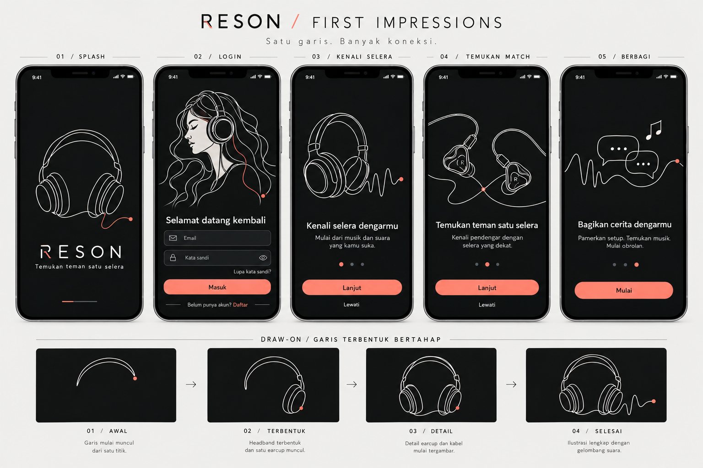

# Reson — Product Requirements Document

Versi: **3.0 — PRD terpadu mobile dan web** • Diperbarui: **1 November 2026** • Bahasa: Indonesia

**Keputusan aktif:** aplikasi Android tetap React Native + Expo; versi web dibangun sebagai frontend **Next.js + React** terpisah. Keduanya menggunakan **Supabase Auth, PostgreSQL, Storage dan SQL RPC yang sama per environment**. Google Sign-In ditambahkan untuk kedua platform; email/password dipertahankan sebagai fallback.

Dokumen ini adalah satu sumber spesifikasi aktif untuk fitur, desain, arsitektur, audit, revisi autentikasi Android/web, task, QA dan rilis. Semua kebutuhan implementasi tercantum di sini; dokumen terpisah menjadi riwayat pendukung. Firebase dan Expo Web tidak berlaku sebagai stack aktif. Audit kondisi mobile aktual; jangan ulangi task lama yang sudah selesai. Dua ilustrasi tersedia di folder assets; sertakan folder itu saat memindahkan PRD.

Status: mobile sudah berjalan pada preview menurut pemilik. Source diaudit pada commit `a0f8ac0`; Next.js dan Google Auth belum diimplementasikan oleh revisi dokumen ini. Pemeriksaan source tidak memverifikasi konfigurasi Supabase live.

## 1. Ringkasan produk

**Reson** adalah aplikasi komunitas audio yang membantu pengguna menemukan pendengar dengan selera serupa, bertukar pengalaman, dan mengeksplorasi perangkat serta musik.

Tagline: **Temukan orang yang mendengar seperti kamu.**

Pembeda utama: **Taste Match**, pencocokan preferensi suara, genre, dan kebiasaan mendengarkan dengan alasan yang dapat dipahami. Hasil tidak menjamin pengguna akan menyukai perangkat yang sama dan bukan ukuran keahlian seseorang.

Alur nilai utama:

> Daftar → mengenali selera → bergabung ke komunitas → menemukan pendengar yang relevan → membaca pengalaman → mengikuti dan berdiskusi → membagikan pengalaman sendiri.

### 1.1 Pengguna sasaran

| Pengguna | Kebutuhan | Solusi Reson |
|---|---|---|
| Pemula | Bingung istilah audio dan mencari referensi pertama | Kuis bahasa sederhana, pilihan belum tahu, komunitas Audio Pemula |
| Penggemar audio | Membandingkan pengalaman orang dengan selera relevan | Taste Match, review berkonteks, katalog |
| Pemilik setup | Membagikan perangkat dan alasan pemilihannya | Showcase yang terhubung ke perangkat |
| Penjelajah musik | Menemukan musik dan teman diskusi | Music Discovery dan tautan lagu |

### 1.2 Sasaran produk dan evaluasi

- Pengguna dapat menyelesaikan registrasi, profil, dan kuis tanpa memahami jargon audio.
- Pengguna dapat menjelaskan alasan sebuah profil direkomendasikan.
- Dua akun nyata dapat mengikuti, posting, berkomentar, dan menerima notifikasi dalam aplikasi.
- Reviewer dapat menelusuri perangkat, review, penulis, dan setup tanpa kehilangan konteks.
- Pantau penyelesaian onboarding, kontribusi pertama, pembukaan profil dari Match, follow setelah Match, dan percakapan yang mendapat balasan. Target numerik ditentukan setelah pilot; jangan mengarang angka pencapaian.

## 2. Scope aktif dan prinsip implementasi

### 2.1 Wajib
- Pertahankan fitur mobile yang sudah berjalan, tanpa membangun ulang backend atau menghapus data existing.
- Web Next.js App Router + React + TypeScript; responsive untuk desktop, tablet dan browser mobile.
- Supabase menjadi satu-satunya backend aktif: Auth, database PostgreSQL, Storage, RLS dan RPC existing.
- Google Sign-In untuk Android dan web; login password, recovery, finalisasi username dan reauthentication tetap lengkap.
- Feature parity web: profil/selera, komunitas, post/komentar, follow/like/simpan, Taste Match, katalog/review/showcase, notifikasi, laporan/blokir, pengaturan dan penghapusan akun.
- Desain charcoal/coral dan ilustrasi line-art tetap dipertahankan; layout web disesuaikan, bukan layar mobile diperbesar.
- EAS untuk mobile; Next server hosting untuk web. Tidak membuat pipeline Expo Web sebagai produk web final.

### 2.2 Di luar scope
Chat pribadi, marketplace, video, streaming musik, harga toko real-time, AI generatif, komunitas buatan pengguna, push notification, login Apple, dan rilis iOS. Halaman publik v1 terbatas pada landing, auth dan legal; konten komunitas tetap memerlukan login.

### 2.3 Kebijakan pengembangan
- Kontrak schema/RPC aktual di repository adalah sumber kebenaran teknis. Fitur dalam PRD yang belum tersedia ditandai gap, bukan diklaim selesai.
- Tidak memakai Firebase/Firestore/Cloud Functions atau membuat database web terpisah.
- Shared validation/types/logic boleh dibagi; UI native dan React DOM dipisahkan.
- Perubahan backend dilakukan lewat migration additive/backward-compatible dan diuji terhadap APK lama.
- Informasi eksternal yang perlu pemilik: akun hosting, domain, Google OAuth client IDs, signing certificates, konfigurasi Supabase dan kontak kebijakan. Jangan meminta secret dikirim di chat.
- Versi dependency dipilih berdasarkan kompatibilitas aktual dan dikunci; tidak memperbarui React Expo hanya untuk mengikuti Next.

## 3. Referensi desain yang disetujui

### 3.1 Layar utama — charcoal dengan aksen coral


### 3.2 Splash, login, pengenalan dan storyboard line-art



Kedua gambar merupakan mockup raster dan acuan visual, bukan komponen siap pakai atau animasi berjalan. Urutan kolom pada gambar tidak menetapkan urutan navigasi. Jika ada ketidakkonsistenan teks/ikon pada gambar, spesifikasi tertulis berlaku.

**Arah visual final menggantikan versi amber dan gothic sebelumnya.**

| Elemen | Ketentuan |
|---|---|
| Nuansa | Minimalisme teknis/editorial dengan pengaruh cyberpunk yang halus |
| Latar | Charcoal sekitar `#111214` |
| Surface | Graphite sekitar `#1B1D20` |
| Teks utama | Putih hangat sekitar `#EEECE8` |
| Teks sekunder | Abu sekitar `#A7A5A0` |
| Aksen | Coral sekitar `#E77768` |
| Tipografi | Sans serif bersih untuk isi; monospace terbatas untuk metadata |
| Bentuk | Garis tipis, kartu sederhana, radius kecil; tombol utama mudah dikenali |
| Foto | Warna natural yang tenang; tidak dipaksa menjadi grayscale |
| Larangan | Blackletter, ornamen gothic, bingkai katedral, neon berlebihan, HUD rumit |

Warna di atas adalah token awal; uji kontras sebelum final. Pada tombol coral gunakan warna teks yang lulus uji kontras. Status harus punya label/ikon selain warna. Area sentuh minimal 44×44 unit logis, dukung pembesaran teks, safe area, keyboard, dan layar Android kecil.

### 3.3 Motion dan ilustrasi

- Line-art tipis: headphone, dua IEM dengan kabel terhubung, gelombang suara, percakapan, dan pendengar memakai headphone.
- Garis putih hangat terbentuk bertahap dengan titik/segmen coral sebagai aksen.
- Animasi utama sekitar 1–2 detik, sekali tiap layar masuk; tidak menghalangi tombol.
- Login: ilustrasi bergerak sekali lalu diam saat pengguna mengisi form.
- Pengenalan: animasi halaman aktif saja; tidak berputar terus di halaman yang tidak terlihat.
- Reduce Motion: tampilkan ilustrasi selesai langsung.
- Native splash memakai gambar/logo statis. Setelah runtime siap, layar intro React Native menjalankan animasi; jangan menjanjikan draw-on di native splash OS.
- Mobile: aset SVG path sendiri + animasi stroke memakai library yang kompatibel dengan Expo SDK terpilih. Web: SVG DOM dan CSS stroke animation. Validasi dukungan Expo Go sebelum menetapkan library. Raster referensi tidak otomatis dapat dianimasikan sebagai path.
- Hindari menahan pengguna hanya untuk menyelesaikan animasi. Jika bootstrap lambat, tampilkan loading bermakna, retry/error bila diperlukan, bukan progress palsu.

## 4. Arsitektur informasi dan alur

### 4.1 Navigasi utama

Lima tab: **Beranda / Community / Match / Jelajah / Profil**. Tombol buat post tersedia di Beranda dan Community. Notifikasi lewat ikon lonceng; simpanan dan pengaturan lewat profil.

### 4.2 Alur bootstrap

1. Native splash statis, muat font dan pulihkan sesi.
2. Pengunjung baru melihat pengenalan tiga layar; Lewati langsung ke pilihan masuk/daftar.
3. Pengguna tanpa sesi menuju login/daftar.
4. Akun baru menyelesaikan username/profil dan kuis; pilihan belum tahu diperbolehkan.
5. Akun yang pernah melewati kuis dapat melengkapinya nanti; Match menunjukkan ajakan melengkapi bila data tidak cukup.
6. Pengguna bersesi yang onboarding-nya selesai masuk Beranda.
7. Verifikasi email wajib sebelum menerbitkan post, komentar, atau interaksi sosial; membaca dan menyusun profil tetap tersedia.

V1 mewajibkan login untuk membaca komunitas. Penjelajahan anonim dapat ditambahkan kemudian. Guard navigasi hanya UX; otorisasi tetap diperiksa di backend.

### 4.3 Alur inti lainnya

- Komunitas → gabung → buat post (komunitas terisi otomatis) → pratinjau → terbitkan → detail post.
- Jelajah → perangkat → review → profil penulis → follow atau simpan.
- Match → alasan kecocokan → profil → review/setup → follow.
- Post → komentar → balasan → notifikasi penulis → kembali ke percakapan.
- Pengaturan → hapus akun → autentikasi ulang bila diperlukan → konfirmasi → pekerjaan penghapusan server → keluar.

## 5. Spesifikasi layar dan fitur

### F01 — Autentikasi dan pengaturan akun

Login/daftar email-password, tampil/sembunyikan password, validasi, loading, pesan kesalahan yang aman, reset password, kirim ulang verifikasi dengan cooldown, logout. Simpan sesi dengan persistence React Native yang didukung SDK. Jangan menyimpan password di tabel aplikasi atau log. Web memakai sesi cookie melalui @supabase/ssr; persistence React Native hanya untuk mobile.

Username awal 3–24 karakter huruf kecil, angka, underscore; unik dan direservasi atomik. Username final tidak dapat diganti di v1. Akun Google boleh mengganti username sementara server satu kali saat finalisasi profil. Display name dan bio dapat diedit.

Google Sign-In menjadi opsi utama di login/daftar; email/password tetap tersedia. Akun Google baru menyelesaikan username setelah autentikasi, akun existing mempertahankan UID dan data. Reauthentication hapus akun harus mendukung Google dan password. Lihat detail autentikasi bagian 6 dan arsitektur bagian 7.

Kriteria selesai: sesi pulih setelah restart; submit ganda tidak membuat data duplikat; profil yang gagal dibuat setelah Auth signup dapat dipulihkan pada login berikutnya.

### F02 — Pengenalan dan Sound Profile

Tiga pengenalan: Kenali selera / Temukan teman satu selera / Bagikan cerita. Kuis: maksimal lima genre, bass/vokal/treble skala 1–5 atau belum tahu, dan konteks mendengarkan. Perangkat milik pengguna opsional.

Simpan jawaban belum tahu sebagai null. Tampilkan penjelasan bahasa awam; hasil dapat diubah. Jangan menyimpulkan kemampuan pendengaran atau kepribadian. Tandai profil awal jika cakupan jawaban sedikit.

Kriteria selesai: jawaban bertahan antar-langkah; kembali tidak menghapus input; hasil dan edit konsisten; pengguna dapat melewati kuis tanpa terkunci.

### F03 — Profil

Avatar, display name, username, bio, follower/following, tombol Ikuti/Berhenti mengikuti untuk orang lain; Edit untuk diri sendiri. Sound Profile, tab Post/Review/Setup, perangkat milik dan incaran. Tab Review/Setup mengambil post yang sama berdasarkan tipe.

Email, preferensi notifikasi, blokir, simpanan dan hasil match pribadi tidak boleh berada dalam tabel profil publik. Pengguna dapat menonaktifkan keterlihatan Sound Profile dan partisipasi Match.

### F04 — Community

Enam awal: IEM & Earbuds, Headphone Corner, Portable Audio, Desk Setup, Music Discovery, Audio Pemula. Hub memiliki Komunitasmu dan Temukan komunitas; tombol Gabung hanya untuk yang belum diikuti.

Detail: deskripsi, aturan, keanggotaan, post disematkan, Terbaru/Populer/Belum terjawab. Populer v1 memakai jumlah like dalam rentang kandidat waktu terbatas yang dijelaskan, bukan klaim seluruh waktu. Belum terjawab berlaku untuk pertanyaan tanpa komentar aktif dari pengguna lain.

Satu post masuk satu komunitas. Join berbeda dari follow akun. Pengguna yang keluar tetap memiliki post lamanya; tidak dapat membuat post baru di komunitas tersebut sebelum bergabung lagi.

### F05 — Post dan composer

Tipe: discussion, question, review, showcase. Maksimal judul 120 karakter, body 5.000 karakter, empat foto; validasi di klien dan server. Diskusi/pertanyaan wajib teks; review wajib perangkat; showcase wajib nama setup dan minimal satu komponen.

Composer: pilih tipe/komunitas → isi → foto/tag perangkat → pratinjau → terbitkan. Draf lokal dipisah per akun dan dibersihkan saat logout agar tidak bocor ke akun berikutnya. Retry menggunakan request ID agar tidak menggandakan post.

Foto dikompres, batas akhir awal 5 MB/file, tipe JPEG/PNG/WebP sesuai dukungan upload; periksa MIME dan ukuran. Simpan path aset di database. Bersihkan upload yang tidak pernah dipublikasikan.

Penulis dapat mengedit isi dan menghapus post; authorId, communityId dan type tidak dapat diganti setelah terbit pada v1. Konten tersembunyi/terhapus tidak boleh dapat dibaca dari deep link atau simpanan.

### F06 — Review dan showcase

Review: perangkat, status milik/pinjaman/sponsor, kesan bass/vokal/treble, kenyamanan, kelebihan/kekurangan, perangkat pendamping dan tautan lagu referensi opsional. Kesan suara jelas bersifat subjektif.

Showcase: nama, foto, tujuan, cerita, komponen terurut (HP → DAC → IEM), kesan pemilik. Komponen dapat mengarah ke katalog; item bebas untuk komponen yang belum tersedia diberi label, bukan dibuat seolah sudah diverifikasi.

Review/showcase berbagi ID post, like, simpan, dan komentar; jangan menduplikasi konten per halaman.

### F07 — Komentar dan interaksi

Komentar maksimal 1.000 karakter; satu tingkat balasan. parentCommentId harus merujuk komentar utama pada post yang sama. Komentar utama yang dihapus menjadi tombstone jika balasan masih ada, tanpa mempertahankan isi yang dihapus.

Like satu per UID, bisa dibatalkan. Follow satu arah, tidak bisa diri sendiri, bisa dibatalkan. Simpan bersifat privat. Optimistic UI harus rollback saat server menolak. Hitungan adalah data turunan dan tidak dapat diedit sembarang klien.

### F08 — Beranda dan feed

Untukmu v1: post terbaru dari topik pilihan/gabungan komunitas, dengan penyaringan blokir; tidak diberi klaim rekomendasi AI. Mengikuti: hanya post aktif penulis yang diikuti. Empty state menawarkan komunitas atau Match.

Pagination default 20, cursor stabil createdAt + document ID. Pull-to-refresh, loading awal, loading halaman lanjutan, error/retry, dan akhir daftar wajib. Jangan memasang listener real-time ke seluruh feed; gunakan fetch bertahap. Refresh setelah kembali dari composer.

### F09 — Taste Match

Rumus berikut merupakan baseline produk. Saat port web, gunakan RPC dan algoritma yang sudah terimplementasi sebagai sumber kebenaran; laporkan perbedaan terhadap baseline dan jangan mengubah scoring mobile diam-diam.

Bobot awal: karakter suara 50%, genre 30%, konteks 20%. Nilai belum tahu tidak dinilai sebagai ketidakcocokan.

- Kesamaan tiap dimensi suara: `1 - abs(a-b)/4`; rata-rata dimensi yang sama-sama dijawab.
- Genre/konteks: Jaccard, yaitu ukuran irisan dibagi ukuran gabungan. Jika salah satu belum memberi data, bagian tersebut tidak dinilai.
- Normalisasi bobot hanya pada komponen tersedia.
- Coverage suara = jumlah dimensi bersama / 3. Coverage total = 0,5 × coverage suara + 0,3 jika genre kedua pihak tersedia + 0,2 jika konteks kedua pihak tersedia.
- Ambang baseline yang perlu diuji: coverage < 0,6 → Kecocokan awal; selain itu score ≥ 0,8 → Sangat dekat, ≥ 0,6 → Cukup dekat, sisanya Sebagian selera sama. Simpan angka internal, tampilkan label dan alasan.
- Alasan menyebut kesamaan nyata dan perbedaan; jangan menciptakan alasan dari data kosong.
- Exclude diri sendiri, akun suspended/deleting, profil non-discoverable, serta blokir dua arah.
- Kandidat dibatasi, misalnya maksimal 200/proses dari genre bersama dan sampel eksplorasi yang dipaginasi. Hasil bukan pencarian global sempurna.
- Cache privat, TTL awal 24 jam; perubahan profil pemilik membatalkan hasil. Validasi ulang revision/status/discoverable kandidat sebelum ditampilkan.
- Endpoint refresh dibatasi lajunya; gunakan versi algoritma agar hasil lama bisa dikenali.

Kriteria selesai: hasil deterministik untuk input yang sama; kasus null, daftar kosong, coverage kecil, profil identik/berlawanan, blokir dan perubahan profil diuji.

### F10 — Jelajah dan katalog

Tab Perangkat/Post/Pengguna. Pencarian v1: prefix nama/username/judul yang dinormalisasi, kategori dan tag; jelaskan keterbatasannya, jangan menyebut full-text/fuzzy search jika belum dibuat. Pencarian kosong menampilkan kategori.

Detail perangkat: foto, nama, merek, kategori, spesifikasi dengan sumber, Punya/Incar, review, showcase terkait. Katalog dibuat admin; pengguna dapat mengusulkan perangkat lewat formulir yang masuk antrean admin. Tidak ada harga pasar otomatis.

### F11 — Notifikasi dalam aplikasi

Jenis follow, komentar pada post, dan balasan komentar. Server membuat notifikasi; jangan kirim untuk aksi sendiri. ID event deterministik mencegah duplikat. ReadAt hanya dapat diubah penerima. Buka menuju target; target yang dihapus menunjukkan pemberitahuan yang tepat. Push ditunda.

### F12 — Moderasi, blokir dan penghapusan akun

Lapor post/komentar/pengguna dengan alasan; pelapor tidak bisa membaca laporan orang lain. Moderator melihat antrean dan memilih dismissed/actioned dengan alasan tindakan. Role admin/moderator tidak dapat dibuat pengguna sendiri. Panel moderator minimum boleh berupa route terlindungi dalam aplikasi, dengan backend yang benar-benar memeriksa role.

Blokir dua arah mencegah follow/komentar/interaksi baru antara kedua akun, mengeluarkan mereka dari Match, dan menyaring konten dari feed pengguna yang bersangkutan. Tidak menjanjikan kerahasiaan konten komunitas terhadap akses publik di masa depan. Pemeriksaan interaksi dilakukan server; penyaringan tampilan saja tidak cukup.

Hapus akun: autentikasi ulang, konfirmasi jelas, job server yang idempotent/retryable, status deleting menghentikan penulisan. Bersihkan Auth, profil, Sound Profile, relasi, post/foto, komentar, simpanan, notifikasi terkait dan hasil match. Jika balasan orang lain dipertahankan, gunakan tombstone tanpa isi/identitas akun terhapus. Tentukan retensi minimum laporan moderasi dalam kebijakan; jangan mengklaim semua data terhapus bila ada pengecualian yang belum dijelaskan.


## 6. Revisi login dan signup Android serta web

Supabase tetap provider identitas; screenshot Clerk hanya referensi UI.

### Pengalaman pengguna

- Tambahkan tombol resmi beridentitas Google: **Lanjutkan dengan Google** pada login dan daftar, di atas pemisah **atau masuk dengan email**.
- Pertahankan email/password sebagai fallback agar akun lama tetap bisa masuk. Penghapusan metode lama memerlukan keputusan terpisah.
- Satu tombol Google menangani login pengguna lama dan registrasi pengguna baru.
- Pemilihan akun ditangani UI resmi Google. Daftar akun mengikuti sesi browser/perangkat; tidak dijamin semua Gmail di HP muncul pada browser. Jika belum ada sesi, Google bisa meminta login atau persetujuan.
- Tidak membaca atau membuat sendiri daftar akun Google di perangkat. Tidak meminta akses inbox Gmail.
- Akun baru: Google → profil sementara → pilih username unik/konfirmasi display name → kuis selera atau lewati → Beranda.
- Akun lama: Google → identitas Supabase lama jika linking sah → lanjut ke tujuan semula/beranda; jangan reset profil, post, follow atau Sound Profile.
- Cancel bukan error merah; pulihkan tombol. Loading mencegah double-submit. Tampilkan pesan aman untuk offline/provider disabled/callback expired.
- Gunakan charcoal/coral Reson dan line-art; ikuti pedoman merek Google untuk logo/tombol.

### Pendekatan platform

#### Android

Gunakan integrasi Google native yang kompatibel Expo, dapatkan ID token dan tukarkan lewat Supabase `signInWithIdToken` provider google. Pilih library setelah mengecek versi Expo project yang terbaru. Modul native memerlukan development build; tidak tersedia dalam Expo Go standar. APK lama harus dibangun ulang dengan EAS ketika modul ditambahkan; OTA JavaScript saja tidak cukup.

Konfigurasi Google memerlukan client ID yang sesuai, package name dan sertifikat penandatanganan build. Periksa sertifikat development/preview serta Play App Signing secara terpisah. Verifikasi audience/nonce sesuai dokumentasi SDK; jangan menonaktifkan validasi nonce sebagai jalan pintas.

#### Web

Keputusan terbaru: implementasi web berada di Next.js App Router dengan @supabase/ssr dan cookie session. Callback adalah Route Handler; browser dan server client dipisah. Boundary autentikasi/cache tercantum pada bagian 7; GA-03 memiliki implementasi Google web dan NX-03 memiliki recovery web.

Gunakan `signInWithOAuth({ provider: 'google', ... })` dengan callback web dan PKCE/code exchange yang konsisten. Jika ingin pemilihan akun eksplisit, gunakan opsi Google `prompt=select_account` sesuai integrasi. Tombol tidak menjamin pemilihan selalu satu ketukan; Google mengontrol UI dan autentikasi.

Callback tetap dapat dijangkau sebelum guard login/onboarding mengambil alih. Validasi returnTo sebagai path internal, bukan redirect arbitrer. Allowlist localhost, preview terpilih dan production secara terpisah. OAuth client secret hanya berada di konfigurasi server/provider Supabase, tidak di EXPO_PUBLIC atau repository.

### Blocker yang ditemukan pada snapshot audit

Snapshot lokal commit a0f8ac06d5f4e0d5a5c3605d16c7bdf0487b11d4; periksa ulang HEAD sebelum implementasi.

1. `supabase/migrations/20261027000000_auth_provisioning.sql`: handle_new_user mengambil metadata username; bila kosong memakai string kosong. Constraint profiles.username mewajibkan 3–24 karakter. Google tidak menyediakan username Reson, sehingga signup pertama berisiko gagal pada trigger. Jangan hanya menambah tombol.
2. `src/features/account/deleteAccount.ts`: penghapusan meminta signInWithPassword. Akun Google-only tidak memiliki password Reson. Reauthentication perlu cabang Google, memverifikasi UID yang kembali sama dengan target; batal jika pengguna memilih akun lain. RPC server juga harus memvalidasi sesi yang memenuhi syarat freshness. Jangan menghapus proteksi tersebut.
3. `src/lib/supabase/client.ts`: detectSessionInUrl false, belum ada callback OAuth/recovery di snapshot. Selesaikan callback dan guard sebelum mengaktifkan provider untuk semua pengguna.

### Provisioning dan kompatibilitas akun

Baseline usulan: buat username sementara valid yang dibuat server dengan penanganan bentrok, lalu simpan penanda profile_completed/username_finalized. Pada akun email/password existing, backfill completed tanpa mengubah username. Akun Google baru baru dapat berinteraksi sosial setelah finalisasi profil; enforce di backend, bukan hanya route guard.

RPC finalisasi username atomik, UNIQUE tetap menjadi penjaga terakhir. Metadata nama/avatar Google hanya data profil yang divalidasi, tidak pernah menentukan role. Jangan menimpa nama/avatar akun lama setiap login.

Supabase menyediakan automatic identity linking berdasarkan email dengan aturan verifikasi yang berlaku. Uji migrasi akun email/password terverifikasi dan akun development yang dahulu auto-confirmed. Jangan membuat mekanisme penggabungan manual hanya berdasarkan string email dari klien. Periksa hasil UID dan identitas, bukan hanya kesamaan nama/email tampilan.

### Task dan subtask

- [ ] GA-01 Audit HEAD dan provider configuration tanpa menyalin secret ke log.
  - [ ] Catat Google client IDs, package name, sertifikat build dan domain yang belum tersedia.
  - [ ] Periksa ulang trigger provisioning, constraints, guard dan reauthentication.
- [ ] GA-02 Buat migrasi provisioning Google yang backward-compatible.
  - [ ] Tambah penanda profil lengkap dan backfill akun existing.
  - [ ] Tambah fallback username server valid, finalisasi atomik dan pembatasan aksi sebelum lengkap.
  - [ ] Uji signup email tetap berjalan serta bentrok username tidak menghasilkan duplikat.
- [ ] GA-03 Implementasikan Google login web.
  - [ ] Tombol, redirect, callback/code exchange, returnTo internal dan loading/error/cancel.
  - [ ] Pastikan recovery password tetap bekerja dan tidak tertangkap guard yang salah.
- [ ] GA-04 Implementasikan Google login Android.
  - [ ] Pasang native SDK/config plugin yang kompatibel, token exchange Supabase.
  - [ ] Konfigurasi signing/client IDs, buat EAS development dan preview build.
  - [ ] Pertahankan email login untuk Expo Go; tandai Google membutuhkan development build, jangan tampilkan tombol yang diam saat diklik.
- [ ] GA-05 Adaptasikan onboarding/profil serta penghapusan akun.
  - [ ] Pilih username hanya saat profil belum lengkap; profil lama tidak ditimpa.
  - [ ] Reauthentication Google untuk hapus akun dengan UID yang sama dan validasi freshness server.
  - [ ] Uji memilih akun Google berbeda pada reauth: tidak boleh menghapus akun mana pun.
- [ ] GA-06 QA lintas platform.
  - [ ] Akun Google baru, pengguna lama, email sama, username bentrok, cancel dan jaringan putus.
  - [ ] Logout lalu ganti akun, refresh web, restore sesi Android, expired callback.
  - [ ] UID/data sama saat login Google di Android dan web.
  - [ ] Reset email, login password dan penghapusan akun untuk kedua jenis akun.
- [ ] GA-07 Rilis.
  - [ ] Aktifkan provider/consent audience dengan pemilik; credentials tidak disimpan ke klien.
  - [ ] Deploy web callback dan build APK baru; tes production signing sebelum rollout.
  - [ ] Perbarui dokumen kebijakan bila pengumpulan nama/avatar/provider berubah.

Dependensi: GA-01 → GA-02; GA-03 juga membutuhkan NX-02; GA-04 membutuhkan GA-02; GA-05 membutuhkan GA-03/04; GA-06 membutuhkan GA-05 dan NX-03; GA-07 membutuhkan GA-06 dan gate rilis bagian 10. Dependensi eksternal belum tersedia bukan alasan menandai integrasi selesai. Jangan melakukan migrasi/destructive reset data existing untuk menambahkan provider.

### Referensi

- https://supabase.com/docs/guides/auth/social-sign-in/auth-google
- https://supabase.com/docs/guides/auth/auth-identity-linking
- https://docs.expo.dev/guides/google-authentication/


## 7. Audit dan spesifikasi implementasi Next.js + Supabase

### Audit sumber

Repo: https://github.com/ptnusavisionmedia/reson, commit `a0f8ac06d5f4e0d5a5c3605d16c7bdf0487b11d4`. Fetch pada tanggal audit tidak menemukan perubahan HEAD. Ini audit source untuk keputusan arsitektur; aplikasi Next.js belum dibuat dan build Next.js belum diuji.

| Bagian | Temuan | Keputusan |
|---|---|---|
| `shared/validation/*.ts` | Zod tanpa ketergantungan UI native | Pakai bersama setelah resolusi package diuji |
| `shared/matching/score.ts` | Algoritma murni dan fixture | Pakai untuk test/paritas; produksi tetap memakai RPC Match |
| `src/types/database.ts` | Kontrak Supabase | Jadikan generated types bersama, jangan ketik ulang schema web |
| `supabase/migrations/` | Tabel, RLS, grant/revoke, RPC | Tetap satu sumber migrasi dan backend |
| `src/features/posts/api.ts` | RPC terikat singleton client serta helper Storage Expo | Pisahkan adapter/inject client; jangan impor langsung ke Next server |
| `src/features/profiles/api.ts` | Kompresi foto memakai Expo ImageManipulator | Buat pipeline browser berbasis File/Blob dan kompresi |
| `src/features/posts/usePosts.ts`, `src/features/match/useMatches.ts` | Hooks memakai useFocusEffect dari Expo Router | Adaptasi lifecycle web; tidak bisa langsung dipakai di Server Component |
| `src/features/posts/PostCard.tsx` | Pressable/Text dan Expo Router | Bangun ulang dengan HTML semantik + Next Link |
| `src/lib/supabase/client.ts` | AsyncStorage, AppState, detectSessionInUrl false | Khusus mobile; web punya browser/server client sendiri |
| `src/components/ui/DrawOnIllustration.tsx` | SVG path dan Reanimated | Pakai path artwork; render SVG DOM dan animasi web |
| `web/` | Halaman legal statis, bukan Next app | Pindahkan isi final ke route publik Next; arsipkan setelah URL diuji |
| Auth provisioning | Username wajib dari metadata pada trigger | Perbaiki untuk Google signup sebelum aktivasi provider |
| Hapus akun | Reauthentication password-only | Tambah alur Google tanpa menghilangkan pemeriksaan UID/freshness |

Tidak diperlukan migrasi database hanya untuk menambahkan frontend Next.js. Backend perubahan Google harus berupa migrasi baru yang kompatibel dengan APK lama. Jangan membangun ulang SQL menjadi Firestore atau menggandakan bisnis RPC di Server Actions.

Bukti audit sebelumnya yang tetap relevan pada commit yang sama: TypeScript lulus, 37 unit tests lulus, Expo web export lulus menggunakan konfigurasi dummy, legal check gagal karena 14 placeholder. Hasil tersebut **bukan bukti kesiapan Next.js, browser authenticated, atau Supabase production**.

Temuan terperinci serta gate perbaikannya tersedia pada tabel audit berikut. Solusi web sekarang komponen React DOM, bukan adapter React Native Web. Audit ini menggantikan rekomendasi satu UI Expo Web.

### Temuan audit terpadu dan gate perbaikan

Snapshot: commit a0f8ac06d5f4e0d5a5c3605d16c7bdf0487b11d4. Periksa ulang HEAD sebelum implementasi. P1 menghalangi alur inti; P2 perlu ditutup atau dinilai sebelum publik.

| ID / prioritas | Bukti source pada snapshot | Kriteria perbaikan | Task |
|---|---|---|---|
| A01 / P1 | supabase/migrations/20261027000000_auth_provisioning.sql: username metadata kosong melanggar constraint | Google signup mendapat username sementara valid; finalisasi atomik; akun lama utuh | GA-02 |
| A02 / P1 | src/features/account/deleteAccount.ts: password-only reauth | Google-only bisa reauth; UID berbeda ditolak; freshness server wajib | GA-05 |
| A03 / P1 | src/app/(auth)/forgot-password.tsx dan src/lib/supabase/client.ts: callback/recovery belum lengkap | Reset email sampai password baru bekerja; expired link dan mobile deep link tertangani | NX-03, GA-05 |
| A04 / P1 untuk port Expo Web | Alert RN web no-op di komentar, blokir, hapus akun/post dan notifikasi | Next menggunakan dialog DOM aksesibel; cancel aman, confirm tidak double-submit. Bukan bug Alert Android | NX-04/06/08 |
| A05 / P2 | Screen.tsx dan tab layout berorientasi mobile | Next responsive di 360/768/1280/1440 px tanpa overflow | NX-04 |
| A06 / P2 | useSignedUrls.ts: TTL 3600 tanpa refresh saat expiry/focus | Refresh terbatas, akses terbaru tetap diperiksa | NX-07 |
| A07 / P2 | web/ hanya legal, belum ada Next | Build server Next dan direct URL/callback di hosting nyata | NX-01/10 |
| A08 / gate publik | Legal check: 14 placeholder dan dua DRAF | Kontak/retensi/pengelola nyata, check legal di lokasi baru lulus | NX-10, GA-07 |

Belum diverifikasi: browser terautentikasi, Google OAuth nyata, Supabase live/RLS live, upload, regression Android, dan deployment. Export Expo bukan uji Next.js. Risiko yang perlu diuji meliputi sesi dua tab, cleanup ketika tab crash, deep link setelah login, dan performa jaringan nyata. Cleanup orphan server harus memiliki masa tenggang, pemeriksaan referensi objek dan retry idempotent; jangan menghapus upload aktif berdasarkan usia saja.

### Stack web yang dipilih

| Kebutuhan | Teknologi / keputusan |
|---|---|
| Framework | Next.js App Router + React + TypeScript strict |
| Styling | Tailwind CSS; token charcoal/coral melalui CSS variables |
| Komponen | HTML semantik; shadcn/ui untuk dialog/form primitives bila sesuai, ditata mengikuti Reson |
| Ikon | Lucide React; artwork line-art SVG milik Reson |
| Form | React Hook Form + Zod shared validation |
| Auth/data | @supabase/supabase-js + @supabase/ssr |
| Rendering | Server Components untuk initial data; Client Components untuk state, dialog, composer dan interaksi |
| Mutasi | Server Actions terautentikasi → RPC Supabase; upload dapat langsung dari browser sesuai Storage policies |
| State | Local React state; tidak menambah Redux/global store secara default |
| Test | Unit test schema/logic, component tests yang relevan, Playwright browser E2E |
| Hosting | Target Vercel untuk Next server runtime; pilih plan setelah memeriksa kebutuhan dan ketentuannya |
| Mobile | Expo/Expo Router tetap; EAS Build/Submit/Update khusus jalur mobile |

Pilih versi stabil yang didukung pada bootstrap dan kunci lockfile. React mobile harus mengikuti dukungan Expo; jangan upgrade React root sembarang untuk menyamakan Next. Isolasi dependency web dan mobile. Tailwind/shadcn adalah pilihan implementasi, bukan izin mengubah identitas desain. Tidak mengasumsikan layanan hosting gratis tanpa batas.

### Auth Next.js dan Google

1. Buat `lib/supabase/browser.ts` memakai createBrowserClient dan `server.ts` memakai createServerClient dengan cookie adapter per request.
2. Refresh cookie melalui `proxy.ts` sesuai versi Next yang dipilih (middleware bila versi tersebut memakai istilah lama). Teruskan cookie dengan benar pada respons redirect.
3. Jangan percaya getSession saja untuk otorisasi server. Gunakan verifikasi getClaims/getUser yang sesuai; periksa status akun dan izin di setiap jalur mutasi. RLS/RPC tetap penentu akses data.
4. Jangan berbagi singleton server client antar-request. Jangan cache halaman, sesi, signed URL atau payload privat di CDN/global cache lintas pengguna. Respons yang mengubah cookie tidak boleh masuk cache bersama.
5. Google web memakai OAuth PKCE, `/auth/callback` sebagai Route Handler untuk exchangeCodeForSession, lalu redirect ke tujuan internal tervalidasi. Bedakan Google → Supabase callback dengan Supabase → Reson callback.
6. Halaman reset password dan callback recovery tidak boleh tersapu guard yang langsung mengirim sesi ke dashboard.
7. Pengguna Google baru menuju finalisasi username lalu Sound Profile. Akun lama mempertahankan UID/data. Detail provisioning/linking mengikuti bagian 6.
8. Web dan APK memiliki sesi masing-masing. Kesamaan backend berarti kesamaan akun/data, bukan login otomatis lintas perangkat.
9. Publikasikan hanya URL dan publishable/anon key sebagai NEXT_PUBLIC. Secret/service_role tidak masuk browser; alur pengguna biasa tetap memakai sesi pengguna, termasuk dari server. Jangan memakai admin key untuk melewati RLS agar halaman bekerja.
10. Server Actions dan Route Handlers memvalidasi input, autentikasi serta izin setiap kali; tombol tersembunyi dan layout guard bukan otorisasi. Mutasi bukan GET; jaga origin/CSRF sesuai jalur cookie auth yang digunakan.

### Struktur repo — transisi minim gangguan

Tahap pertama mempertahankan aplikasi Expo di root. Jangan memindah semua source mobile sekaligus hanya demi monorepo.

```text
reson/
  src/                         # mobile existing
  assets/                      # aset mobile existing
  app.json
  eas.json
  package.json                 # mobile existing
  package-lock.json
  shared/
    validation/                # schema portable existing
    matching/                  # algoritma referensi existing
    types/database.ts          # target kontrak bersama; mobile re-export bila perlu
  supabase/migrations/         # satu sumber schema/RLS/RPC
  apps/
    web/
      package.json             # dependency Next terisolasi
      package-lock.json
      next.config.ts
      tsconfig.json
      .env.example
      public/illustrations/
      src/
        app/
          layout.tsx
          globals.css
          page.tsx             # landing publik
          (auth)/login/page.tsx
          (auth)/register/page.tsx
          (auth)/forgot-password/page.tsx
          (auth)/update-password/page.tsx
          auth/callback/route.ts
          (onboarding)/complete-profile/page.tsx
          (onboarding)/sound-profile/page.tsx
          (main)/layout.tsx
          (main)/home/page.tsx
          (main)/communities/page.tsx
          (main)/communities/[communityId]/page.tsx
          (main)/match/page.tsx
          (main)/explore/page.tsx
          (main)/posts/[postId]/page.tsx
          (main)/posts/new/page.tsx
          (main)/posts/[postId]/edit/page.tsx
          (main)/devices/[deviceId]/page.tsx
          (main)/users/[userId]/page.tsx
          (main)/profile/page.tsx
          (main)/saved/page.tsx
          (main)/notifications/page.tsx
          (main)/settings/page.tsx
          (main)/settings/delete-account/page.tsx
          (main)/moderation/page.tsx
          privacy/page.tsx
          delete-account/page.tsx # informasi/permintaan publik
          loading.tsx
          error.tsx
          not-found.tsx
        components/ui/
        components/layout/
        features/
        lib/supabase/browser.ts
        lib/supabase/server.ts
        lib/supabase/proxy.ts
        lib/auth/require-user.ts
        lib/data/
        proxy.ts
      tests/e2e/
  web/                         # legal lama, jangan dihapus sebelum pengganti siap
```

Untuk shared source di luar apps/web, atur alias, resolusi dependencies, dan tracing/build root secara eksplisit lalu buktikan pada CI. Alternatif sesudah baseline stabil: ubah shared menjadi workspace package dengan public exports. Hindari menyalin schema secara manual. Build hosting harus menyertakan shared di repository root, bukan hanya mengunggah apps/web tanpa dependencies-nya. Jika pindah ke workspaces, uji ulang Metro/EAS dan cegah dua React dalam satu bundle mobile.

### Data dan feature parity

Schema **aktual** memakai tabel Supabase, bukan rancangan Firestore lama:

`profiles`, `accounts`, `sound_profiles`, `communities`, `community_members`, `devices`, `posts`, `comments`, `post_likes`, `follows`, `saved_posts`, `device_lists`, `blocks`, `notifications`, `match_results`, `device_suggestions`, `reports`, `moderation_audit`, dan tabel proses penghapusan sesuai migrations terbaru.

- Gunakan types yang digenerate dari schema live/staging terverifikasi. Jangan mengarang signature RPC.
- `feed_for_you`, `feed_following`, `create_post`, `edit_post`, `delete_post`, `refresh_matches`, `get_my_matches` sudah ada dalam snapshot. Reuse sesuai signature aktual; mutation adapter menerima client beridentitas pengguna.
- Konten komunitas tetap memerlukan login. Hanya landing, auth dan legal publik. Penggunaan Next tidak otomatis membuka data privat demi SEO. Metadata publik tidak berisi isi post privat atau signed URL.
- Pagination mempertahankan kontrak SQL yang ada; jangan mengganti dengan pengambilan seluruh tabel. Match memakai SQL sebagai sumber produksi; test parity menjaga kesesuaian TypeScript.
- Like/follow/comment selesai → invalidasi data terkait di client/router; hindari stale server-rendered count. Refresh manual tersedia di desktop.
- Storage tetap bucket/path yang sama. Browser menggunakan File/Blob yang divalidasi, preview lokal, kompresi dan upload sesuai policies; UI tidak menerima service_role.
- Signed URL diperbarui saat expiry/focus dengan pembatasan retry. Jangan melewatkan foto privat melalui cache image optimizer publik tanpa strategi privasi yang diuji.
- Cleanup orphan di server; jangan mengandalkan penutupan tab. Jangan menduplikasi deletion logic tanpa mengikuti RPC/fresh-session checks yang ada.

### UX web yang wajib

- Desktop ≥ 1200 px: sidebar kiri, konten utama dibatasi lebarnya, panel kanan opsional. Tablet 768–1199 px: rail lebih ringkas/panel kanan disembunyikan. Mobile < 768 px: satu kolom, bottom navigation.
- Breakpoint ini baseline desain; uji konten 360, 768, 1280, 1440 px. Tidak boleh horizontal overflow pada form/feed.
- Login dua kolom pada desktop: ilustrasi di kiri, form/Google di kanan; satu kolom di HP.
- Match/katalog grid adaptif; post detail menonjolkan isi dan komentar; profil header lebar tanpa memperbesar avatar berlebihan.
- Keyboard: Tab, Enter/Space, Escape dialog; fokus kembali ke pemicu; label input dan pesan error terkait; loading dan toast dapat dibaca assistive technology.
- Navigasi internal memakai Next Link. Back/Forward, tab baru dan refresh URL detail bekerja. Simpan returnTo aman melalui login.
- Line-art memakai SVG DOM + CSS stroke animation; hormati prefers-reduced-motion. Tidak mengimpor Reanimated/Expo ke bundle web.
- Modal konfirmasi dipakai untuk hapus/blokir; tidak memakai Alert.alert native atau langsung menjalankan aksi.
- Tidak memaksakan native splash di web. Halaman awal dan skeleton dibuat cepat, tidak menahan pengguna 2 detik untuk dekorasi.

### Backlog Next.js — task untuk agent

Semua checkbox adalah pekerjaan baru yang belum diverifikasi selesai. Urutan ini menggantikan WEB-01–10 berbasis Expo Web, bukan mengulang fitur mobile yang telah ada.

#### NX-00 · Baseline dan kontrak (tanpa dependency)
- [ ] Catat HEAD, status perubahan lokal, kondisi mobile dan schema/RPC yang digunakan.
- [ ] Petakan reusable code vs native imports; verifikasi shared schema tidak mengimpor Expo.
- [ ] Catat environment/domain/client IDs yang belum tersedia tanpa membocorkan secret.
- Selesai jika: tidak ada asumsi bahwa RLS live identik hanya karena file migration ada.

#### NX-01 · Scaffold Next terisolasi (NX-00)
- [ ] Buat apps/web memakai App Router, React, TypeScript, Tailwind dan lint.
- [ ] Konfigurasi shared imports/types dan scripts dev/build/typecheck/test.
- [ ] Tambahkan .env.example, browser/server boundary dan server-only markers.
- [ ] Uji fresh install/build web serta typecheck dan export Android mobile.
- Selesai jika: dependency web tidak mengubah versi React mobile atau merusak Metro.

#### NX-02 · Supabase SSR dan sesi (NX-01)
- [ ] Buat browser client dan server client per request dengan cookie adapter.
- [ ] Buat token refresh proxy, helper verified user dan status akun.
- [ ] Implementasikan login/logout email, route guards dan safe returnTo.
- [ ] Uji cookies expired, refresh halaman, dua tab dan dua akun; larang shared caching privat.
- Selesai jika: akun A tidak melihat HTML/data akun B dan server action menolak tanpa sesi.

#### NX-03 · Recovery dan integrasi guard (NX-02; integrasi Google setelah GA-03)
- [ ] Implementasikan signup email, konfirmasi email dan resend/cooldown dengan callback web yang benar.
- [ ] Implementasikan forgot-password → callback recovery → update-password → login ulang, termasuk link expired dan retry.
- [ ] Prioritaskan callback/recovery sebelum guard profil/Beranda; pertahankan tujuan internal setelah login.
- [ ] Integrasikan Google GA-03 dan finalisasi profil GA-05 tanpa menduplikasi migration GA-02.
- [ ] Uji fallback password dan akun lama; Google-only tidak diwajibkan membuat password.
- Selesai jika: login, verifikasi, recovery dan onboarding konsisten. SDK/provider dan provisioning dimiliki task GA.

#### NX-04 · Design system web dan shell (NX-01)
- [ ] Implementasikan CSS tokens, font, komponen, sidebar/bottom nav dan layout auth.
- [ ] Port artwork SVG, animasi draw-on dan reduced-motion.
- [ ] Buat dialog aksesibel, skeleton, empty/error/retry dan focus styles.
- [ ] Uji viewport dan keyboard; bandingkan desain charcoal/coral yang disetujui.
- Selesai jika: UI memakai React DOM yang responsive, bukan frame HP diperbesar.

#### NX-05 · Read flows dan navigasi (NX-02, NX-04)
- [ ] Implementasikan Beranda, Community, detail post, profil dan perangkat dengan query/RPC existing.
- [ ] Tambahkan Match, filter dan penjelasan dari get_my_matches, tanpa algoritma web berbeda.
- [ ] Implementasikan Jelajah dan pagination sesuai kontrak; hindari fetch semua data.
- [ ] Buat link detail, not-found/hidden, metadata privat aman dan returnTo.
- Selesai jika: konten nyata staging terbaca sesuai hak akun, bukan fixture saja.

#### NX-06 · Interaksi dan composer (NX-05)
- [ ] Port form discussion/question/review/showcase memakai shared schema dan form library.
- [ ] Implementasikan like/follow/join/comment/save lewat server action → RPC dengan user client.
- [ ] Validasi ulang setiap mutasi, request ID/idempotency, loading, optimistic rollback.
- [ ] Implementasikan edit/hapus dan dialog; invalidasi UI setelah mutasi.
- Selesai jika: akses server tetap menolak request terlarang meski UI dilewati.

#### NX-07 · Media dan lifecycle browser (NX-06)
- [ ] Buat file picker, kompresi, batas file, preview dan retry; bersihkan object URLs.
- [ ] Pakai bucket/path yang sama; refresh signed URL saat diperlukan.
- [ ] Tambahkan draf per akun dan peringatan meninggalkan form yang belum selesai.
- [ ] Rancang cleanup orphan terjadwal dan uji kehilangan koneksi/penutupan tab.
- Selesai jika: upload web dapat dibaca mobile sesuai policies tanpa membuka bucket privat.

#### NX-08 · Notifikasi, settings dan moderasi (NX-06)
- [ ] Implementasikan notifikasi/read state, simpanan dan device lists.
- [ ] Implementasikan block/report serta staff UI dengan pemeriksaan izin server.
- [ ] Integrasikan account deletion/resume dengan reauth GA-05, UID sama dan freshness server; jangan buat flow auth kedua.
- [ ] Uji konten hidden, blocked, deleted dan target notifikasi hilang.
- Selesai jika: feature parity inti tercapai tanpa bergantung dialog native.

#### NX-09 · QA lintas platform (NX-03, NX-07, NX-08, GA-05)
- [ ] Jalankan unit/typecheck/lint/build dan Playwright alur utama.
- [ ] Uji post web → baca Android → komentar Android → refresh web; UID/profil/follow sama.
- [ ] Uji akun berbeda, sesi expired, callback, media expiry dan private cache isolation.
- [ ] Uji keyboard, reduced motion, viewport, loading lambat, Back/Forward dan direct URL.
- [ ] Jalankan mobile regression setelah perubahan shared/schema; laporkan hasil aktual terpisah dari rencana.
- Selesai jika: tidak ada blocker login, kehilangan data, akses lintas akun atau crash.

#### NX-10 · Preview dan rilis web (NX-09)
- [ ] Siapkan Next server hosting, build root/shared dependencies dan environment yang benar.
- [ ] Konfigurasi domain HTTPS, Google/Supabase callbacks dan preview allowlist terbatas.
- [ ] Pindahkan/finalkan legal lama ke route Next; jalankan check legal terhadap lokasi baru.
- [ ] Preview deploy dan smoke test login, callback, URL detail, upload dan RPC.
- [ ] Rilis sesuai otorisasi pemilik; catat URL/commit/deployment dan rollback plan.
- Selesai jika: URL nyata teruji, bukan hanya build lokal. Tidak memakai static export karena cookie SSR/callback membutuhkan runtime.

### Deploy dan operasi

Web: build Next pada server runtime yang kompatibel; target Vercel, biaya/plan ditinjau sebelum aktivasi. EAS tidak digunakan untuk deploy frontend Next ini. Android tetap EAS; perubahan native Google memerlukan build baru. Backend tetap Supabase.

Release schema dilakukan satu kali oleh pipeline/penanggung jawab migrations. Preview tidak otomatis menjalankan migrasi terhadap production. Migrasi additive dahulu agar APK lama terus bekerja; destructive changes menunggu kompatibilitas dan keputusan terpisah.

Pantau kegagalan callback/login, error RPC, Storage, latency dan kuota. Jangan mengklaim skala/biaya berdasarkan tier gratis saja. Untuk web publik, akun data hanya sebatas kebijakan yang ada; Next SSR bukan izin mengakses data lewat service_role.

### Referensi resmi

- [Next App Router](https://nextjs.org/docs/app)
- [Server dan Client Components](https://nextjs.org/docs/app/getting-started/server-and-client-components)
- [Next authentication boundaries](https://nextjs.org/docs/app/guides/authentication)
- [Supabase SSR clients dan cookie refresh](https://supabase.com/docs/guides/auth/server-side/creating-a-client)
- [Google Sign-In Supabase](https://supabase.com/docs/guides/auth/social-sign-in/auth-google)

## 8. Persyaratan nonfungsional

- Ada loading, empty, error, retry dan success pada semua layar berdata.
- Jangan klaim offline penuh. V1 mendukung draf lokal dan pesan jaringan jelas; aksi server membutuhkan koneksi.
- List virtualized, gambar thumbnail, pagination, unsubscribe listener saat tak diperlukan.
- Tidak ada secret/password/token di log atau repository.
- Tautan musik dibuka eksternal; tidak menyimpan audio berhak cipta.
- Unit test fokus algoritma; integration test fokus akses antar-akun, duplikasi, lifecycle konten.
- Log server memiliki request ID tanpa data sensitif; kegagalan job dapat ditelusuri dan diulang.
- Ketika akun diblokir/disembunyikan setelah layar terbuka, refresh dan aksi selanjutnya harus menghormati status terbaru.
- Dokumen kebijakan harus menjelaskan data yang dikumpulkan, visibilitas, penghapusan, dan kontak nyata; jangan mengarang identitas pengelola.

## 9. Definition of Done global

Sebuah fitur selesai bila perilaku utama dan state gagal/empty/loading bekerja, validasi klien/server konsisten, akses antar-akun diuji, desain mengikuti referensi, tidak ada secret atau data contoh yang menyamar sebagai nyata, serta dokumentasi setup diperbarui. Pemeriksaan otomatis dan uji manual harus dilaporkan terpisah.

Agent tidak boleh menandai seluruh milestone selesai hanya karena UI memakai fixture. Nyatakan dengan jelas apakah data masih mock, fixture, Supabase development/staging, atau production. Jangan mengklaim build/store submission/review berhasil tanpa hasil tool atau dashboard yang mendukung.


## 10. Eksekusi terpadu, QA dan rilis

### 10.1 Urutan dan kepemilikan task

GA memiliki provider, provisioning dan reauth kedua platform. NX memiliki frontend Next, cookie SSR, recovery web dan fitur web. Migration dikerjakan sekali untuk kedua frontend. Bukti uji dapat dipakai bersama jika commit/environment/skenario sama dan tercatat.

| Tahap | Task | Gate |
|---|---|---|
| Baseline | NX-00 + GA-01 | HEAD, gap F01–F12, kontrak schema/RPC, konfigurasi yang belum tersedia |
| Fondasi | NX-01 + GA-02 | Next terisolasi, migration staging kompatibel APK lama |
| UI dan sesi | NX-02 + NX-04 | Cookie SSR terverifikasi dan shell sesuai desain |
| Auth | GA-03 + GA-04 + NX-03 | Google web/Android nyata, email dan recovery web |
| Lifecycle profil | GA-05 | Username final, recovery mobile dan reauth aman |
| Fitur web | NX-05 → NX-06 → NX-07 + NX-08 | Parity fitur scope dengan data staging |
| Validasi | GA-06 + NX-09 | E2E kedua platform dan regression APK lama |
| Rilis | NX-10 + GA-07 | Preview smoke test, gate publik, rollout web/APK |

UI/read flows dapat maju memakai akun email staging ketika konfigurasi Google menunggu. Integrasi mock tidak memenuhi kriteria auth selesai. Setiap task memiliki input dependency, checklist pekerjaan dan kriteria selesai; agent wajib mencatat blocker nyata, bukan mencentang task karena UI sudah terlihat.

### 10.2 Subtask tambahan mobile dalam GA-05

- [ ] Lengkapi deep link verifikasi email/recovery, prioritas guard, layar update-password dan expired-link/resend.
- [ ] Uji tautan ketika app tertutup dan terbuka; restore sesi tidak boleh melewati layar recovery.
- [ ] Finalisasi username akun Google baru, backend membatasi interaksi sebelum profil lengkap.
- [ ] Jangan menimpa username/nama/post/follow/Sound Profile akun lama setiap Google login.
- [ ] Reauth memakai provider yang tersedia; Google-only tidak diminta password fiktif.
- [ ] Uji cancel/akun Google berbeda: tidak ada akun yang terhapus; UID dan freshness diverifikasi server.
- [ ] Uji APK lama terhadap schema baru, lalu APK baru dengan signing preview/production yang sesuai.

Kriteria task GA: GA-01 menghasilkan inventaris tanpa secret; GA-02 lulus signup dan regression; GA-03/04 menghasilkan sesi Supabase nyata; GA-05 lulus finalisasi/recovery/deletion; GA-06 lulus matriks berikut; GA-07 memiliki build/deployment dan smoke test nyata.

### 10.3 Matriks pengujian wajib

| Skenario | Platform | Hasil diterima |
|---|---|---|
| Google baru | Android dev/preview dan web | Satu profil valid, finalisasi username, tidak ada trigger error |
| Akun lama/email sama | Keduanya | Linking sesuai aturan Supabase; UID/data benar, tanpa custom merge email |
| Email signup/login | APK lama/baru dan web | Validasi/verifikasi/fallback tetap berfungsi |
| Recovery | Android cold/warm deep link; callback web | Password baru berhasil; expired link dapat dipulihkan |
| Cancel/offline/provider gagal | Keduanya | Tombol pulih, retry aman, tidak loading selamanya |
| Bentrok username | Dua sesi bersamaan | Satu sukses, satu error jelas; constraint UNIQUE tetap menjaga |
| Session lifecycle | Restart Android, refresh/dua tab web | Ganti akun tidak menampilkan data akun sebelumnya |
| Hapus akun | Google/password kedua platform | UID salah ditolak, freshness server wajib, job dapat dilanjutkan |
| Cross-platform | Post web → komentar Android → baca web | Akun, konten, follow dan profil konsisten |
| Otorisasi/cache | Akun A/B/tanpa sesi | Backend menolak akses terlarang; tidak bocor lintas akun |
| Media | Upload, URL expiry, tab ditutup | Policies berlaku; refresh aman; orphan direkonsiliasi |
| UX | Keyboard, direct URL, Back/Forward, font besar | Fokus jelas, tanpa overflow, reduced motion dihormati |

### 10.4 Input konfigurasi dan gate rilis

Diperlukan: Supabase environment/schema terverifikasi, Google consent/audience/client IDs, Android package dan sertifikat signing tiap build, domain HTTPS, hosting Next dengan shared source, EAS profiles, kontak pengelola nyata. Bedakan Google → Supabase callback dari Supabase → Reson callback. Secret disimpan di dashboard/secret store, bukan PRD, chat atau public env.

- [ ] Tutup P1 dan finalkan legal; hasil QA menyebut commit/environment/platform/build serta bukti aktual.
- [ ] Tinjau migration additive dan recovery/backup yang tersedia; jangan reset database existing.
- [ ] Deploy callback web dan build APK dengan signing benar; smoke test akun uji.
- [ ] Pastikan login email tetap bisa dipakai bila Google bermasalah.
- [ ] Siapkan rollback deployment web dan penghentian rollout APK; jangan rollback schema secara destruktif demi UI.
- [ ] Catat URL, versi/build Android, commit, schema version dan keterbatasan sebelum serah terima.

Agent melaporkan task selesai/tertunda, file berubah, migration dibuat versus benar-benar dijalankan, hasil uji aktual, konfigurasi menunggu dan langkah berikutnya. PRD ini tidak menyatakan implementasi Next/Google atau publish sudah selesai.
